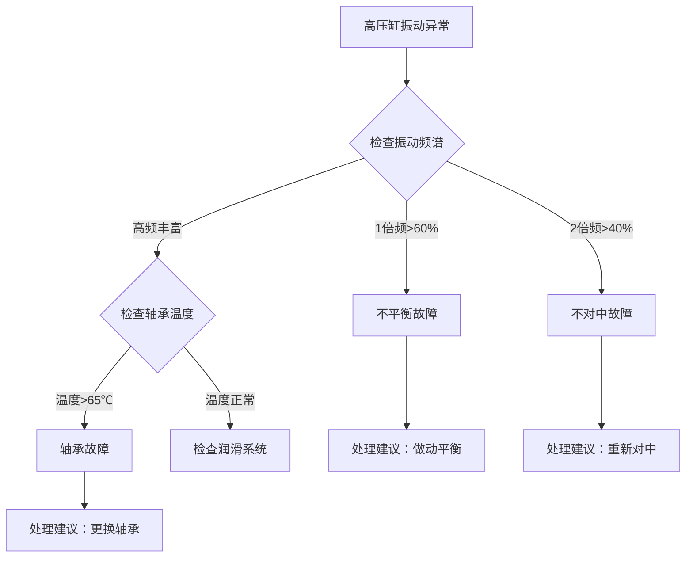

# 第四篇 知识表示层——存成什么格式、什么结构

## 第10章 知识表示的整体框架

### 10.1 四层表示模型

传统知识管理只有"文档"一层，无法同时满足人阅读和AI消费的需求。本方案基于**知识图谱+RAG**的最佳实践，设计了**四层表示模型**：

| 层级 | 表示形式 | 用途 | 消费方 | 占比 |
|:---|:---|:---|:---|:---:|
| **元数据层** | YAML Frontmatter | 检索过滤、溯源管理、版本控制 | AI系统 | 10% |
| **语义层** | Markdown正文 | 人工阅读、RAG语义检索 | 人 + AI | 50% |
| **逻辑层** | Mermaid决策树 | 可视化、推理路径展示 | 人 + AI | 25% |
| **执行层** | JSON实体关系 | 精确计算、图推理、工具调用 | AI系统 | 15% |

### 10.2 每层之间的关联关系

```
用户提问 → 元数据层过滤（按设备/标签/置信度）
           → 语义层检索（找到相关内容）
           → 逻辑层理解（理解判断逻辑）
           → 执行层计算（如需精确计算调用工具）
           → 生成答案
```

**为什么需要四层而非一层？**
单一形式无法同时满足所有消费场景：
- 人需要"可读的"——Markdown正文
- AI检索需要"可过滤的"——元数据
- 理解逻辑需要"可视化的"——决策树
- 精确计算需要"结构化的"——实体关系

四层架构是"人机协同"的必然要求。

---

## 第11章 核心元数据规范（11字段详解）

每个知识条目都必须包含以下11个元数据字段，存储在YAML Frontmatter中：

```yaml
---
# 1. 唯一标识与来源
knowledge_id: "KB-20250115-0042"
source_type: "expert"
title: "汽轮机高压缸振动异常诊断逻辑"
author: "张建国"

# 2. 适用范围与标签
equipment_scope: ["TURB-001", "TURB-002"]
knowledge_tags: ["汽轮机", "振动", "故障诊断", "高压缸"]

# 3. 版本与生命周期
version: "1.2"
status: "active"
effective_date: "2025-01-15"
expiry_date: "2026-01-15"

# 4. 置信度与溯源
confidence_score: 0.88
source_references: 
  - "访谈记录-张工-20250110"
  - "故障工单-2024-GS-0342"
  - "交叉验证-李工-20250114"

# 5. 公式标记（可选）
has_executable_formula: true
formula_tool_name: "vibration_threshold_calculator"
---
```

### 11.1 唯一标识与来源字段详解

**knowledge_id**：知识条目的唯一身份证号
- 生成规则：KB-YYYYMMDD-序号
- 示例：KB-20250115-0042
- 用途：追踪、引用、版本管理

**source_type**：知识来源类型
- 枚举值：expert（专家访谈）、historical_data（历史数据）、document（文档）、cross_validation（交叉验证）
- 用途：区分知识的可靠性等级

**title**：知识条目名称
- 命名规范：[专家名]-[设备名]-[主题]
- 示例："张工-1号汽轮机-高压缸振动异常诊断"
- 要求：清晰、具体、不超过30字

**author**：知识来源专家姓名
- 用途：溯源、署名、问责
- 注意：必须是真实姓名，不能用"设备部"等泛指

### 11.2 适用范围与标签字段详解

**equipment_scope**：适用设备范围
- 格式：数组，至少1个
- 示例：["TURB-001", "TURB-002"]
- 用途：检索时按设备过滤，避免知识误用

**knowledge_tags**：知识分类标签
- 格式：数组，至少3个
- 命名规范：从通用到具体（如["汽轮机", "振动", "高压缸"]）
- 用途：分类管理、检索过滤、统计分析
- 要求：使用企业统一的标签体系，不能随意创建

### 11.3 版本与生命周期字段详解

**version**：版本号
- 格式：语义化版本（主版本.次版本）
- 示例：1.0（初始版本）、1.1（小幅修改）、2.0（重大更新）
- 版本规则：
  - 修正错别字、调整格式：不更新版本号
  - 补充边界条件、新增判断分支：次版本+1
  - 核心判断逻辑变更：主版本+1

**status**：状态
- 枚举值：
  - draft：草稿，待审核
  - active：正常可用
  - superseded：已被新版本替代
  - deprecated：已废弃，不再使用
- 用途：控制知识的可见性和可用性

**effective_date / expiry_date**：生效/过期日期
- 默认有效期：1年
- 到期前30天自动提醒专家复审
- 过期知识默认不召回，需专家确认后延期

### 11.4 置信度与溯源字段详解

**confidence_score**：置信度评分（0-1区间）
- 基础分：0.70（专家经验默认值）
- 加分规则：
  - 有交叉验证：+0.15
  - 有历史数据支撑：+0.10
  - 有多次成功应用记录：+0.05
- 封顶值：0.98（保留不完美空间，没有100%正确的知识）
- 扣分规则：
  - 被反馈错误1次：-0.05
  - 被反馈错误3次：自动标记为待复审

**source_references**：来源引用
- 格式：数组，至少1个
- 内容：访谈记录ID、工单号、文档名等
- 用途：溯源验证、可信度证明

### 11.5 公式标记字段详解（可选）

**has_executable_formula**：是否有可执行公式
- 值：true/false
- 用途：告诉AI系统，回答这个问题需要调用计算工具

**formula_tool_name**：工具注册名称
- 示例："vibration_threshold_calculator"
- 用途：AI系统自动调用对应的计算函数

---

## 第12章 知识内容的四维结构

元数据之后是知识正文，按照以下四维结构组织：

### 12.1 第一维：诊断逻辑链（条件→判断→行动→边界）

这是知识条目的核心内容，必须按照标准化格式书写：

```markdown
## 诊断逻辑链

### 现象描述
高压缸振动值突然升高，超过警戒值（60μm），但未达到停机值（120μm）。

### 判断步骤
1. **第一步**：检查振动频谱
   - 如果1倍频成分占比>60% → 可能是不平衡故障
   - 如果2倍频成分占比>40% → 可能是不对中故障
   - 如果高频成分丰富 → 可能是轴承故障

2. **第二步**：检查轴承温度
   - 如果轴承回油温度>65℃ → 轴承故障可能性增大
   - 如果轴承温度正常 → 排除轴承润滑问题

3. **第三步**：检查负荷变化
   - 如果故障发生在负荷突变后 → 不对中故障可能性增大
```

**为什么必须包含"边界"？**
没有边界的知识是危险的。"轴承温度超过65℃需要停机"这条知识，如果不说明"满负荷运行时"这个边界，在低负荷运行时就可能造成误判。

**边界条件的标准写法**：
```markdown
### 边界条件与例外
✅ 适用条件：
- 机组负荷>70%额定负荷
- 设备运行时间>1000小时（磨合期后）

❌ 不适用条件：
- 机组启停机过程中（参数波动正常）
- 新安装或大修后72小时试运行期间

⚠️ 注意事项：
- 冬季环境温度低时，报警阈值可适当降低5℃
```

### 12.2 第二维：量化阈值（参数+阈值+单位+适用条件）

专家口中的"温度有点高"、"振动有点大"必须转化为精确的量化值：

```markdown
## 量化阈值表

| 参数名称 | 正常范围 | 警戒值 | 停机值 | 单位 | 适用条件 |
|:---|:---:|:---:|:---:|:---:|:---|
| 高压缸振动 | <40 | 60 | 120 | μm | 负荷>70% |
| 轴承回油温度 | 40-55 | 65 | 75 | ℃ | 夏季 |
| 轴承回油温度 | 35-50 | 60 | 70 | ℃ | 冬季 |
| 轴向位移 | <0.2 | 0.4 | 0.6 | mm | 所有工况 |
```

**如何处理专家的"模糊表达"？**
当专家说"大概50多度吧"时，不要强行追问"到底53还是57？"，而是记录为一个区间：
- 警戒值：50-55℃
- 并标注："此阈值为经验值，建议结合现场实际情况调整"

### 12.3 第三维：决策树（Mermaid格式）

用Mermaid流程图可视化整个判断逻辑，让人一目了然：

```markdown
## 诊断决策树


```

**决策树与逻辑链的对应关系**：
- 逻辑链是"线性的"，适合AI理解
- 决策树是"图形化的"，适合人理解
- 两者必须保持一致，内容完全对应

### 12.4 第四维：关系图谱（JSON实体-关系）

这一层是给AI系统做图推理用的，描述知识中涉及的实体和它们之间的关系：

```json
{
  "entities": [
    {"id": "E001", "type": "Equipment", "name": "1号汽轮机高压缸"},
    {"id": "E002", "type": "Parameter", "name": "振动值"},
    {"id": "E003", "type": "Fault", "name": "不平衡故障"},
    {"id": "E004", "type": "Action", "name": "做动平衡"}
  ],
  "relations": [
    {"from": "E002", "to": "E003", "type": "indicates", "condition": "1倍频>60%"},
    {"from": "E003", "to": "E004", "type": "requires"},
    {"from": "E001", "to": "E002", "type": "has_parameter"}
  ]
}
```

**实体类型枚举**：
- Equipment：设备
- Parameter：参数
- Fault：故障
- Condition：条件
- Action：行动

**关系类型枚举**：
- causes：导致
- solves：解决
- indicates：表明
- requires：需要
- triggers：触发
- prevents：防止

**图结构的价值**：
传统RAG只能"找到相关的文本片段"，而图推理可以"沿着关系链进行推理"——比如从"振动值高"出发，找到它可能表明的故障，再找到对应的解决方法，这是真正的"知识推理"。

---

## 第13章 置信度体系——如何评价知识可靠

### 13.1 置信度评分标准详解

| 评分项 | 基础分/加分 | 说明 |
|:---|:---:|:---|
| **基础分** | 0.70 | 专家经验的默认置信度 |
| 交叉验证 | +0.15 | 第二位专家审阅并确认 |
| 历史数据支撑 | +0.10 | 有3个以上历史案例验证 |
| 多次成功应用 | +0.05 | 被用户引用并反馈正确≥5次 |
| **封顶值** | 0.98 | 永远不打满分，保留改进空间 |

**扣分规则**：
- 被反馈"答案错误"1次：-0.05
- 被反馈"答案不完整"1次：-0.02
- 被反馈"与实际情况不符"1次：-0.03
- 置信度低于0.60：自动标记为"待复审"，默认不召回

### 13.2 置信度的使用场景

**智能体排序**：
回答用户问题时，高置信度的知识排在前面，低置信度的知识排在后面并标注"仅供参考"。

**用户提示**：
```
⚠️ 提示：以下建议置信度为0.72，仅供参考，请结合现场实际情况判断。
```

**治理触发**：
- 置信度<0.70：触发专家复审流程
- 置信度<0.60：暂时从召回结果中移除
- 置信度<0.50：自动标记为"可能过时"，通知专家确认

### 13.3 专家如何理解和使用置信度

不要对专家说"这条知识的置信度是0.82"，要说：
- "您对这个判断的把握有几成？"
- "如果满分是10分，您给这个经验打几分？"

然后将专家的打分线性映射到0-1区间：8分→0.80。

**置信度不是"客观真理"，而是"主观把握"的量化表达**——它反映的是专家对这条知识的信心程度，而不是知识本身的"对错"。

---

**本篇参考资料**：
1. 微软亚洲研究院. (2024). *RAG系统知识表示最佳实践*.
2. OpenAI. (2024). *Structured Output Guidelines*.
3. Neo4j. (2024). *Knowledge Graph Construction Guide*.
4. 字节跳动. (2024). *企业知识库元数据规范v2.0*.
