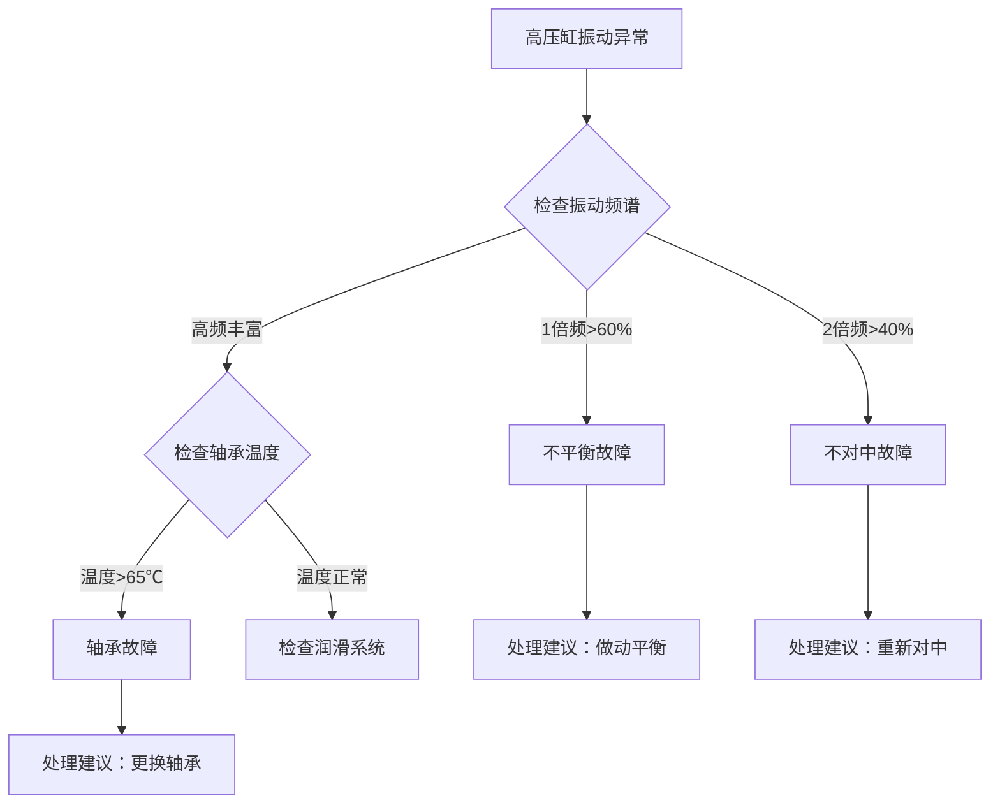

# 专家知识智能化传承与持续运营体系方案

## 版本信息
- **版本号**：v2.0
- **发布日期**：2025年1月
- **文档状态**：正式发布

---

## 前言

当前全球工业正面临前所未有的人才断层危机。一方面，改革开放后第一批成长起来的技术专家正集中进入退休年龄——他们掌握着企业几十年积累的核心经验、"踩坑"总结出来的独门诀窍，是企业最宝贵的资产；另一方面，年轻人越来越不愿意从事传统工业，"招不来、留不住、培养慢"成为普遍难题。

更严峻的是，这些宝贵的专家知识90%以上都存在专家的大脑里——"看不见、摸不着、带不走"。专家一旦退休，这些知识就跟着"退休"了。新员工遇到同样的问题，又要从头"踩一遍坑"。

本方案提供了一套完整的、可落地的专家知识智能化传承体系——从知识萃取、知识表示、知识加工，到智能应用、持续运营，再到风险控制和实施路线图。整套体系基于APQC、Gartner、德勤等权威机构的知识管理理论，结合西门子、宝马等工业巨头的实践经验，以及大模型和RAG技术的最新发展，旨在帮助企业系统性地解决"专家知识断层"问题。

---

# 第一篇 总论——为什么要做专家知识智能化

## 第1章 企业面临的专家知识危机

### 1.1 人才断层：大规模退休潮与知识流失

全球工业领域正面临前所未有的人才断层危机。根据**Gartner 2025年知识管理调研报告**显示，到2025年，全球制造业约有30%的资深技术专家将达到退休年龄，这意味着企业可能在短短5年内流失近三分之一的核心技术知识。

在中国，这一问题更为严峻。工信部2024年发布的《制造业人才发展规划》数据显示，我国技能劳动者总量超过2亿人，但高技能人才仅占28%，且其中45岁以上人员占比超过60%。未来5-10年，工业企业将迎来一波集中退休潮，大量积累了几十年的隐性知识将随专家一同离开企业。

**真实案例**：
> 某大型石化企业2023年数据显示，因核心设备专家退休导致的产线非计划停机时间同比增加47%，单次停机平均直接经济损失超过300万元。该企业负责催化裂化装置的首席工程师退休后，连续3个月内发生2起因类似故障处理不当导致的减产，累计损失超过1200万元。

知识流失的成本远不止直接的生产损失。**德勤《2025全球人力资本趋势》报告**指出，企业每失去一名资深专家，需要花费其年薪1.5-2.5倍的成本来重新培养替代人员，且知识断层期间的生产效率下降可达30%-50%。

### 1.2 知识孤岛：个人能力与组织能力的失衡

在大多数工业企业中，核心技术知识高度集中在少数"关键人物"手中。典型表现是：关键设备的故障诊断依赖1-2个人，新产品开发的核心技术掌握在少数专家手里，一旦这些人离职或退休，整个业务线将面临严重冲击。

**APQC（美国生产力与质量中心）2025年全球知识管理调研**显示：
- 68%的企业承认存在"单点依赖"问题，即关键决策依赖于1-2名专家
- 52%的企业因关键人员离职导致过重大项目延误或失败
- 45%的企业表示员工平均花费超过2小时/天查找"别人知道但自己不知道"的信息

这种个人能力与组织能力的严重失衡，使企业处于极高的脆弱性之中。知识不是企业的资产，而是专家个人的"私产"——企业只是在"租用"这些知识，却从未真正"拥有"它们。

### 1.3 传承困境：传统师徒制的规模化难题

师徒制作为工业文明最古老的知识传承方式，在今天面临着"传不了、传不快、传不全"的三重困境：

**传不了**——现代工业的复杂性远超个人经验边界。一名资深工程师可能需要10-15年才能独立处理所有复杂工况，但企业的发展节奏要求知识传承在1-2年内完成。

**传不快**——传统"手把手"的传承效率极低。一名专家一年最多能带2-3名徒弟，按照这个速度，企业的知识断层永远无法补上。

**传不全**——师傅往往不会"倾囊相授"。一方面是"留一手"的文化惯性，另一方面是大量隐性知识"只可意会不可言传"，连专家自己都无法清晰表达出来。

更严峻的是，新一代年轻人不再接受"熬十年成师傅"的职业路径。麦肯锡2024年调研显示，95后员工在同一岗位的平均任职时间仅为2.3年，传统师徒制"先熬五年再上手"的模式已完全不适应新一代人才的成长节奏。

### 1.4 竞争压力：智能化转型的知识底座缺失

当前，几乎所有企业都在推进智能化转型，但普遍陷入"有算力无知识"的尴尬境地——买了最先进的AI服务器、部署了最强大的大模型，却发现AI根本不懂企业的具体业务。

**Gartner 2025年技术趋势报告**指出：
> 73%的企业AI项目无法实现预期ROI，核心原因不是算法不够先进，而是缺乏高质量的领域知识作为底座。没有结构化的专家知识，AI就是无源之水、无本之木。

这是一个典型的"倒金字塔"困境：企业在算力上投入了80%的预算，在数据上投入了15%，但在最核心的"知识"上投入不到5%。结果是，AI能回答通用问题，但解决不了企业的具体问题——它知道"轴承故障怎么办"，但不知道"我们厂这台30年的老机组轴承出现某种异音时应该怎么办"。

没有专家知识的智能化，只是"空中楼阁"。

---

## 第2章 问题的本质——专家知识为什么难以传承

### 2.1 专家知识的本质特征

专家知识之所以难以传承，根源在于其四个本质特征：

**隐性化**——大量知识"只可意会不可言传"。**野中郁次郎（Ikujiro Nonaka）**在其经典的**SECI模型**中指出，企业中80%的知识是隐性知识，包括直觉、判断、诀窍、思维模式等，这些知识无法通过文档或培训直接传递，只能通过"社会化-外显化-融合化-内隐化"的螺旋过程逐步转化。

一个有30年经验的设备专家，听到设备的异常声音就能判断出故障类型，但他无法清晰说出"为什么"——这就是典型的隐性知识，是多年经验内化形成的直觉判断。

**情境化**——专家知识与特定设备、特定工况、特定环境深度绑定。"轴承温度超过55℃需要停机"这条知识，在夏季和冬季、满负荷和半负荷、新设备和老设备上的适用性可能完全不同。脱离具体情境的知识不仅没用，甚至可能有害。

**动态化**——专家知识不是静态的"真理"，而是随环境变化持续修正的"活经验"。设备老化、工艺调整、原材料变化都会导致原有的经验失效，需要持续更新。传统文档库模式的最大问题就是知识一旦写入就"死"了。

**碎片化**——专家知识不是系统性的理论体系，而是大量非结构化的判断片段。一个故障的诊断逻辑，可能散落在专家的记忆中、笔记本上、甚至与同事的聊天记录里，从未被系统整理过。

### 2.2 传统知识管理为什么失败

过去30年，企业尝试了各种知识管理方法，但绝大多数以失败告终：

**文档库模式**——建个Wiki或共享盘，让大家上传文档。结果是：存了但没人查（检索太麻烦）、查了但看不懂（上下文缺失）、看了但用不上（与当前情境不符）。**APQC调研**显示，企业文档库的平均使用率不到15%，85%的文档上传后从未被打开过。

**专家系统模式**——上世纪80年代风靡一时，试图用"IF-THEN"规则把专家知识写进计算机。结果是：规则写不全（专家说不出所有规则）、维护成本高（每次更新都要找专家）、无法适应变化（环境变了规则就失效）。到90年代末，90%以上的专家系统项目都被废弃。

**师徒制模式**——最原始也最有效的方式，但无法规模化。如前所述，一名专家一年最多带2-3名徒弟，面对当前的大规模知识断层，师徒制只是"杯水车薪"。

传统知识管理失败的根本原因在于：它们都试图把专家知识变成"死的文档"或"硬的规则"，但专家知识本质上是"活的经验"，需要在使用中学习、在反馈中进化。

### 2.3 智能化时代的新可能

大模型和智能体技术的出现，为专家知识传承带来了前所未有的新可能：

**AI作为"知识催化剂"**——AI可以帮助专家把碎片化的经验转化为结构化知识。过去需要专家花10小时写的文档，现在AI可以根据1小时的访谈录音自动生成草稿，专家只需要修改确认，效率提升10倍以上。

**大模型作为"推理引擎"**——知识不再是"死"在文档里，而是可以被大模型理解、推理、应用。用户可以用自然语言提问，大模型根据知识库中的专家知识给出针对性的答案，而不是让用户自己去"找文档"。

**智能体作为"传承载体"**——智能体可以"继承"专家的知识和思维方式，成为可复制、可规模化的"数字专家"。一个智能体可以同时服务成千上万的一线人员，彻底打破传统传承方式的规模限制。

这不是传统知识管理的"升级版"，而是**范式级的革命**——从"人找知识"到"知识找人"，从"静态文档"到"动态推理"，从"人工维护"到"闭环进化"。

---

## 第3章 本方案的解决之道——顶层设计思路

### 3.1 核心命题

> 将专家头脑中的隐性经验，转化为可复用、可推理、可进化的显性知识资产，并封装为可被一线人员直接使用的智能体服务。

这句话包含三层含义：

1. **知识转化**——从"专家脑中"到"结构化知识"，解决"挖出来"的问题
2. **知识资产化**——从"个人私产"到"企业资产"，解决"留下来"的问题
3. **知识服务化**——从"被动查阅"到"主动服务"，解决"用起来"的问题

### 3.2 关键设计原则

**原则一：以终为始——从"智能体怎么用"倒推"知识怎么存"**

传统知识管理是"专家怎么说就怎么记"，结果是记了很多但AI用不了。本方案反其道而行之：先定义智能体的使用场景和输入输出，再倒推知识应该用什么格式存储、包含哪些字段。

例如：智能体需要根据"设备型号+故障现象+当前工况"给出诊断建议，那么知识条目中就必须包含"适用设备"、"故障特征"、"边界条件"、"判断逻辑"等结构化字段。

**原则二：人机协同——AI辅助专家萃取，而非替代专家判断**

不要试图用AI"取代专家"，那既不可能也不现实。正确的定位是：AI是专家的"知识助理"，负责做繁琐的整理、结构化、验证工作，让专家专注于最有价值的判断和决策。

具体分工：
- AI做：录音转写、自动生成草稿、逻辑缺口检测、格式校验
- 专家做：内容确认、边界设定、冲突裁决、质量把关

**原则三：渐进显性——不追求一次性"挖空"专家，而是持续迭代**

不要期望通过几次访谈就能把专家几十年的经验全部"掏空"，那不现实。正确的策略是：
- 第一轮：先萃取60%-70%的核心知识，让智能体先"能用"
- 第二轮：在使用中发现知识缺口，持续补充和完善
- 第三轮：通过反馈闭环让知识自动进化

知识萃取不是"项目"，而是"持续的过程"。

**原则四：闭环驱动——从使用中学习，从反馈中进化**

知识库不是"写完就结束"，而是"越用越好"。每次用户提问、每次专家修正、每次实际验证，都是知识库进化的机会。

本方案设计了完整的反馈闭环：用户使用智能体→用户反馈答案是否正确→反馈进入知识库→AI自动识别知识缺口→通知专家补充或修正→知识库更新→下一次回答更准确。

### 3.3 方案全景图：六层架构

```
┌─────────────────────────────────────────────────────────────────────────────┐
│                    专家知识智能化传承六层架构                                │
├─────────────────────────────────────────────────────────────────────────────┤
│                                                                             │
│  第⑥层  持续运营层      →  保鲜机制 · 纠错闭环 · 激励体系                   │
│  ─────────────────────────────────────────────────────────────────────────  │
│  第⑤层  智能应用层      →  智能体构建 · 知识服务 · 人机协同                 │
│  ─────────────────────────────────────────────────────────────────────────  │
│  第④层  知识加工层      →  知识融合 · 冲突消解 · 质量评估                   │
│  ─────────────────────────────────────────────────────────────────────────  │
│  第③层  知识表示层      →  元数据规范 · 知识结构 · 多模态承载               │
│  ─────────────────────────────────────────────────────────────────────────  │
│  第②层  知识萃取层      →  访谈方法 · 深度挖掘 · 结构化整理                 │
│  ─────────────────────────────────────────────────────────────────────────  │
│  第①层  基础准备层      →  场景选择 · 利益对齐 · 资源盘点                   │
│                                                                             │
└─────────────────────────────────────────────────────────────────────────────┘
```

**六层架构的内部逻辑关系**：

- **第①层（基础准备）是启动前提**——选不对场景、对不齐利益，后面全是白费
- **第②层（知识萃取）是价值源头**——挖不出真东西，后面存什么、用什么？
- **第③层（知识表示）是格式底座**——表示不清、存得不规范，AI无法消费
- **第④层（知识加工）是质量保障**——不融合、不消解冲突，知识库自相矛盾
- **第⑤层（智能应用）是价值兑现**——用不起来，前面所有投入归零
- **第⑥层（持续运营）是生命力来源**——不保鲜、不迭代，知识库迅速贬值

**六层之间的依赖关系**：前一层是后一层的前提，后一层是前一层的价值延伸。任何一层的缺失都会导致整个链条断裂。这也是为什么大多数知识管理项目失败——它们往往只做了其中一两层（比如只建了文档库），没有形成完整的闭环。

---

**本篇参考资料**：
1. Gartner. (2025). *Knowledge Management Maturity Model*. Gartner Document 6906866.
2. Gartner. (2025). *Develop a Knowledge Management Strategy to Enable AI Success*. Gartner Document 6573102.
3. 德勤. (2025). *2025全球人力资本趋势报告*.
4. APQC. (2025). *Global Knowledge Management Survey*.
5. Nonaka, I., & Takeuchi, H. (1995). *The Knowledge-Creating Company*. Oxford University Press.
6. 工信部. (2024). *制造业人才发展规划*.


---

# 第二篇 基础准备层——启动阶段的核心决策

## 第4章 场景选择：从哪个专家、哪个问题开始

### 4.1 场景优先级评估模型

场景选择是整个项目最关键的决策——选错了场景，后续所有投入都会打水漂。根据西门子知识管理中心2024年的实践总结，场景选择应遵循**"小而准"而非"大而全"**的原则，优先选择"痛得明显、容易验证"的场景。

**四维评估模型**：

| 评估维度 | 权重 | 评估标准 | 评分方法 |
|:---|:---:|:---|:---|
| **业务损失度** | 30% | 故障发生时造成的直接+间接经济损失 | 单次损失×年发生频次 |
| **发生频率** | 25% | 该类问题的年均发生次数 | 历史工单统计 |
| **单点依赖度** | 25% | 当前能独立解决该问题的专家人数 | 1人=10分，2人=6分，3人及以上=2分 |
| **专家配合度** | 20% | 专家的意愿程度和时间可用性 | 主观评估（1-10分） |

**优先级计算**：综合得分 = 业务损失度×0.3 + 发生频率×0.25 + 单点依赖度×0.25 + 专家配合度×0.2

**优先级分级**：
- **S级（优先启动）**：综合得分≥80分
- **A级（储备项目）**：综合得分60-79分
- **B级（暂缓启动）**：综合得分＜60分

### 4.2 三类优先场景

**第一类：高痛场景**
- **特征**：损失大、频次高、但目前只有1人能解决
- **典型案例**：某化工企业核心压缩机故障诊断，年均发生12次，单次损失50万元，只有1名工程师能快速定位
- **为什么优先**：ROI最明显，见效最快，容易获得管理层支持

**第二类：急迫场景**
- **特征**：关键专家即将退休/离职（6个月内）
- **典型案例**：某电力公司汽轮机首席专家3个月后退休，该专家掌握30年的机组运维经验
- **为什么优先**：窗口期很短，一旦专家离开，知识就再也"挖"不回来了

**第三类：示范场景**
- **特征**：专家意愿强、知识相对清晰、容易出成果
- **典型案例**：某汽车制造厂焊装车间设备故障诊断，专家本人对AI感兴趣，愿意配合
- **为什么优先**：成功率高，可以作为企业内部的"标杆案例"，为后续推广铺路

### 4.3 避坑指南：这些场景不要选

**❌ 不要选"最复杂"的场景**
很多企业一开始就想解决"最难的问题"，结果半年都出不了成果，项目被砍掉。复杂问题涉及的知识链条太长，萃取难度大，验证周期长，不适合做试点。

**❌ 不要选"最赚钱"的场景**
"最赚钱"的场景往往竞争激烈，涉及的利益方多，专家的戒备心重，配合度低，知识萃取难度大。

**❌ 不要选"涉及所有人"的场景**
场景越具体越好。"设备故障诊断"太泛，"1号汽轮机振动异常诊断"才是好的场景定义。

**如何说服高层选择"对"的场景**：
1. 用数据说话：展示每个场景的预期ROI计算
2. 降低预期：明确告知"第一个场景是打基础，不是做原子弹"
3. 承诺快速交付：承诺3个月内出可用的Demo，6个月内见实际效果

---

## 第5章 利益对齐：让关键角色都愿意参与

### 5.1 四类关键角色及其核心诉求

任何知识管理项目的失败，本质上都是"人的失败"——关键角色没有看到价值，不愿意参与。

| 角色 | 核心诉求 | 常见担忧 | 如何满足 |
|:---|:---|:---|:---|
| **高层管理者** | ROI、风险控制、战略价值 | "花这么多钱，能有什么效果？" | 量化ROI计算、里程碑节点、风险预案 |
| **一线专家** | 时间成本、被替代焦虑、个人价值认可 | "教会了AI，还要我干什么？" | 明确角色定位、署名权、荣誉激励 |
| **一线操作工** | 易用性、准确性、能否真正帮到自己 | "AI说的对吗？听了出错谁负责？" | 人机协同机制、免责条款、使用反馈权 |
| **IT/数据部门** | 技术可行性、安全合规、运维成本 | "这东西能和现有系统对接吗？" | 技术方案评估、安全设计、运维移交计划 |

### 5.2 专家不配合的深层原因与应对策略

"专家不配合"是项目最常见的卡点。根据宝马集团知识管理团队2024年的内部报告，83%的知识萃取困难源于专家意愿问题，而非技术问题。

**不配合的五种深层原因及应对**：

| 不配合原因 | 具体表现 | 应对策略 |
|:---|:---|:---|
| **时间压力** | "我太忙了，没时间搞这些" | ① 将访谈拆分为30分钟短轮次<br>② AI辅助准备，减少专家时间消耗<br>③ 争取其上级协调工作时间 |
| **被替代焦虑** | "教会了AI，还要我干什么" | ① 明确告知：AI复制的是"初级判断"，复杂问题仍需专家<br>② 让专家成为"教练"而非"被替代者"<br>③ 将专家署名嵌入知识条目（如"张工诊断模型V1.0"） |
| **认为没价值** | "这些东西写了也没人看" | ① 先做一个快速Demo，让专家看到实际效果<br>② 展示知识被引用的数据看板<br>③ 邀请专家参与产品命名（增强归属感） |
| **怕说错担责** | "我说的要是错了怎么办" | ① 明确标注"经验性建议，需结合现场判断"<br>② 建立免责机制：知识仅作参考，最终决策由人负责<br>③ 由专家自己设定"适用条件"和"边界" |
| **表达困难** | "我会做但说不清楚" | ① 改用"你做我看"的方式（观察实际操作）<br>② AI自动生成草稿，专家只需"修改"而非"创作"<br>③ 用具体案例引导，而非抽象提问 |

**核心原则**：不要试图"说服"专家，要让专家"看到价值"。一个能亲眼看到的Demo，比10页PPT的说服力强100倍。

### 5.3 利益交换的设计

让各方都"有利可图"，项目才能顺利推进：

**对管理层**：
- 可量化的ROI：预计降低故障停机时间X%，减少经济损失Y万元
- 风险缓释：解决Z个单点依赖岗位，降低人才流失风险
- 战略价值：构建企业知识资产，为智能化转型打基础

**对专家**：
- 降低重复劳动：AI帮着回答一线的重复问题，专家可以专注于复杂问题
- 个人品牌建设：知识署名、内部讲师身份、专家荣誉认证
- 工作减负：AI帮忙整理文档、写报告，减少案头工作

**对一线操作工**：
- 降低学习成本：不用熬5年成师傅，AI随时可以请教
- 减少出错率：AI辅助决策，降低误操作风险
- 提高工作效率：故障诊断更快，维修质量更高

---

## 第6章 资源盘点与基线测量

### 6.1 需要盘点的三类资源

**专家资源盘点**：
| 盘点项 | 说明 | 记录格式 |
|:---|:---|:---|
| 专家名单 | 领域专家、资深工程师 | 姓名、岗位、工龄、专业领域 |
| 时间可用性 | 每周能抽出多少时间配合 | 小时/周 |
| 配合意愿 | 主观意愿程度 | 1-10分 |
| 知识领域 | 精通的设备/工艺/问题类型 | 标签化 |
| 即将退休时间 | 6个月内/1年内/1年以上 | 时间节点 |

**历史资料盘点**：
- 故障记录：近3年的设备故障工单、维修记录
- 操作手册：设备说明书、操作规程、维护指南
- 培训资料：历史培训PPT、视频、考试题库
- 专家笔记：专家的个人工作笔记（如果愿意提供）

**工具环境盘点**：
- 当前是否有知识库/文档管理系统
- 大模型部署情况（公有云/私有云/本地部署）
- IT团队的AI技术能力
- 数据安全合规要求

### 6.2 如何建立效果基线

没有基线，就无法衡量效果。项目启动前必须建立以下基线：

**效率基线**：
- 当前故障诊断平均时间：从接到报修到定位原因的平均时长
- 知识查找平均时间：一线人员找答案的平均时长
- 首次修复率：一次就修好的比例

**质量基线**：
- 误判率：故障诊断错误的比例
- 返工率：维修后再次出现同样问题的比例
- 停机时间：平均每次故障的停机时长

**风险基线**：
- 单点依赖岗位数：只有1人能处理的关键岗位数量
- 即将退休专家数：1年内将退休的资深专家数量
- 知识流失风险等级：高/中/低

**基线测量方法**：
1. 提取近6个月的历史工单数据进行统计分析
2. 对10-20名一线人员进行访谈和问卷调查
3. 与3-5名专家进行确认和校准

### 6.3 启动条件检查清单

满足以下所有条件，项目方可启动：

| 检查项 | 必须满足 | 验证方法 |
|:---|:---|:---|
| ✅ 明确的试点场景 | 已选定1-2个S级场景，有具体的设备/问题范围 | 场景评估报告 |
| ✅ 专家愿意配合 | 至少1名核心专家明确表示愿意配合，每周可提供≥4小时 | 专家确认函/面谈记录 |
| ✅ 高层基本支持 | 部门总监及以上领导知晓并支持该项目 | 立项审批/会议纪要 |
| ✅ 有历史数据 | 至少有6个月的故障记录/维修日志 | 数据抽样检查 |
| ✅ 基础IT环境 | 可以访问大模型API（公有云/私有云均可） | 技术验证 |

**不具备启动条件时的替代路径**：
- 如果专家不配合：先做一个"微型Demo"，用公开知识+少量历史数据做个原型，让专家看到潜力
- 如果高层不支持：先做一个"零成本试点"，用免费工具、业余时间做，拿出成果后再申请资源
- 如果没有历史数据：从"访谈+观察"开始，边做边积累数据

---

**本篇参考资料**：
1. 西门子知识管理中心. (2024). *工业企业知识萃取实践指南*.
2. 宝马集团. (2024). *内部知识管理项目经验总结报告*.
3. APQC. (2024). *Knowledge Management Implementation Playbook*.
4. Gartner. (2024). *How to Measure KM ROI*.


---

# 第三篇 知识萃取层——如何从专家脑中"挖"出知识

## 第7章 访谈模板的设计——解决"问什么、谁来问"

### 7.1 通用逻辑框架：金字塔式访谈法

知识萃取不是"聊天"，而是有结构、有目的的系统性挖掘。根据麦肯锡访谈方法论和GE全球研发中心的实践经验，我们采用**金字塔式访谈法**：

```
顶层：共创式提问（确认逻辑、整合体系）
  ↑
中层：激发式提问（穷尽分支、挖掘边界）
  ↑
底层：响应式提问（还原事实、收集案例）
```

**底层——响应式提问**：
- 目的：收集具体事实和案例，不做判断
- 典型问题："你遇到过哪些典型故障？""当时是什么现象？""你是怎么处理的？"
- 要点：不要问"为什么"，先问"是什么"

**中层——激发式提问**：
- 目的：穷尽所有可能的分支，挖掘知识边界
- 典型问题："如果不是这个原因呢？""夏天和冬天会有什么不同？""如果当时不这么做，会发生什么？"
- 要点：用"反事实提问"打破专家的思维惯性

**顶层——共创式提问**：
- 目的：确认整体逻辑，形成知识体系
- 典型问题："你能画一下这个故障的判断流程图吗？""这些判断之间是什么关系？"
- 要点：让专家成为"创造者"，而不是"被审问者"

### 7.2 模板的"骨架"——五环问题框架

每一个知识主题的访谈，都应该覆盖以下五个环节，形成完整的闭环：

| 环节 | 核心问题 | 产出物 |
|:---|:---|:---|
| **场景还原** | 这个问题在什么情况下发生？有哪些典型现象？ | 故障场景列表、现象描述 |
| **诊断推理** | 你是怎么一步步判断原因的？先看什么、再看什么？ | 诊断逻辑链 |
| **决策分支** | 不同的现象分别对应什么原因？为什么？ | 决策树分支 |
| **边界条件** | 这个判断在什么情况下适用？什么情况下不适用？ | 适用条件、例外情况 |
| **量化阈值** | 各个参数的警戒值是多少？超过多少需要采取行动？ | 参数阈值表 |

**每个环节的标准问题模板**：

**场景还原**：
- "请描述3个你印象最深的该类故障案例"
- "这些故障发生时，设备有什么异常现象？（声音、温度、振动、参数等）"
- "故障发生前，通常有什么征兆？"

**诊断推理**：
- "接到报修后，你第一步会做什么？为什么？"
- "如果第一步检查没问题，接下来你会看什么？"
- "你是根据什么判断是这个原因，而不是那个原因的？"

**决策分支**：
- "如果出现A现象，你会怎么判断？如果出现B现象呢？"
- "这两种故障现象很像，你是怎么区分的？"
- "有没有出现过判断错误的情况？当时是哪里错了？"

**边界条件**：
- "这个经验在什么设备上适用？什么设备上不适用？"
- "夏天和冬天、满负荷和半负荷，判断标准会有不同吗？"
- "新设备和运行了10年的老设备，处理方式一样吗？"

**量化阈值**：
- "这个参数正常范围是多少？超过多少需要警惕？超过多少必须停机？"
- "你说的'温度有点高'，大概是多少度？"
- "振动值达到多少你会建议安排检修？"

### 7.3 模板的"血肉"——企业总工提供什么

AI工程师提供访谈的"骨架"，企业总工需要提供"血肉"——具体的领域上下文：

**设备清单输入格式**：
```yaml
equipment:
  - id: "TURB-001"
    name: "1号汽轮机"
    model: "N300-16.7/537/537"
    service_years: 15
    key_parameters: ["主蒸汽温度", "主蒸汽压力", "振动值", "轴向位移"]
```

**术语映射表**：
| 口语表达 | 标准术语 | 说明 |
|:---|:---|:---|
| "机子喘" | 喘振 | 压缩机流量减小时出现的不稳定工况 |
| "油温飘" | 油温波动 | 润滑油温度不稳定 |
| "轴瓦响" | 轴瓦异常振动 | 轴承磨损或润滑不良导致的异响 |

**典型痛点案例（3-5个）**：
每个案例包含：时间、现象、处理过程、最终结果、经验教训

### 7.4 模板的动态校准——AI系统如何实时调整

访谈不是"按剧本念台词"，AI系统需要根据专家的回答实时调整提问策略：

**关键词触发机制**：
- 当专家说"夏天/冬天" → 自动追问："夏天和冬天的判断标准具体有什么不同？"
- 当专家说"老设备/新设备" → 自动追问："老设备和新设备的具体差异是什么？"
- 当专家说"不一定/看情况" → 自动追问："能具体说一下分哪几种情况吗？"

**逻辑缺口检测**：
- 当专家说了"如果A就X" → AI自动检测并追问："那如果不是A呢？会是什么情况？"
- 当专家描述了现象但没说原因 → AI自动追问："出现这个现象的原因可能有哪些？"
- 当专家说了处理方式但没说边界 → AI自动追问："这种处理方式在什么情况下不能用？"

### 7.5 模板最终形态示例

`interview_schema.yaml`完整结构：

```yaml
interview_schema:
  version: "1.0"
  topic: "汽轮机振动异常故障诊断"
  expert: "张工"
  interviewer: "AI系统+业务分析师"
  
  phases:
    - name: "场景还原"
      questions:
        - "请描述3个你印象最深的该类故障案例"
        - "这些故障发生时，设备有什么异常现象？"
        - "故障发生前，通常有什么征兆？"
      expected_output:
        - fault_cases: list
        - symptoms: list
        - early_warning: list
    
    - name: "诊断推理"
      questions:
        - "接到报修后，你第一步会做什么？为什么？"
        - "如果第一步检查没问题，接下来你会看什么？"
        - "你是根据什么判断是这个原因的？"
      expected_output:
        - diagnostic_process: flowchart
        - decision_logic: chain
    
    # ... 其他环节
```

**版本管理**：每次访谈后更新版本号，记录新增和修改的内容。

---

## 第8章 访谈执行——如何"挖得深、挖得全"

### 8.1 双人访谈模式

**为什么需要双人模式？**
单人访谈有天然的局限性：访谈者既要引导流程、又要记录、还要追问，很难同时做好。而且单个访谈者容易有思维盲区，漏掉重要的提问角度。

**角色分工**：

| 角色 | 负责人 | 职责 |
|:---|:---|:---|
| **流程引导者** | AI工程师 | 控制访谈节奏、按照模板提问、提醒时间、AI实时辅助 |
| **深度追问者** | 企业业务专家 | 听懂专业内容、发现逻辑缺口、进行深度追问、验证内容准确性 |

**操作规范**：
1. 每次访谈不超过60分钟（专家注意力极限）
2. 流程引导者负责开场、介绍目的、控制时间
3. 深度追问者在专家回答完一个问题后进行追问
4. 两人在访谈前提前沟通重点，访谈后15分钟内同步发现的问题

### 8.2 三层追问法

很多时候专家的第一回答只是"冰山一角"，需要通过三层追问才能挖到真正的知识：

**第一层追问：做了什么？（还原事实）**
- 目的：确认客观发生的事实，不加入主观判断
- 典型问题："当时你具体做了什么操作？""先看了哪个参数？""数值是多少？"
- 要点：不要问"你当时怎么想的"，先问"你当时做了什么"

**第二层追问：为什么这么做？（还原决策逻辑）**
- 目的：挖掘专家做决策时的思考过程
- 典型问题："为什么先看这个参数而不是那个？""你当时是怎么判断不是其他原因的？"
- 要点：关注"排除逻辑"——专家排除了哪些可能性？为什么排除？

**第三层追问：怎么知道的？（还原判断依据）**
- 目的：挖掘知识的来源和置信度
- 典型问题："这个经验你是怎么总结出来的？""有没有出过差错？""有数据支撑吗？"
- 要点：区分"亲身经验"和"听来的知识"，两者的置信度不同

**第四层追问：边界在哪？（还原适用条件）**
- 目的：明确知识的适用范围和例外情况
- 典型问题："这个方法在什么情况下不适用？""有没有反例？"
- 要点：专家常常"默认"某些前提，需要主动挖掘出来

### 8.3 三重保障机制：杜绝"挖一半漏一半"

**第一重：AI实时补问提示**
- AI系统实时监听访谈内容，自动检测逻辑缺口
- 当发现专家只说了一个分支、漏掉其他分支时，自动在屏幕上弹出提示："建议追问：如果不是这个原因呢？"
- 当发现边界条件不明确时，自动提示："建议确认：这个判断的适用条件是什么？"

**第二重：专家回读确认**
- 访谈结束后24小时内，AI自动生成访谈纪要和初步的知识条目
- 专家回读确认："这是你说的意思吗？有没有遗漏？有没有错误？"
- 专家可以直接修改、补充、批注

**第三重：同源交叉验证（可选）**
- 如果有2名以上专家在同一领域，让第二位专家审阅第一位专家的知识条目
- 重点关注：有没有不同的判断逻辑？有没有遗漏的边界条件？
- 差异本身就是重要的知识

### 8.4 访谈节奏控制

**四轮访谈法**：

| 轮次 | 时长 | 目标 | 间隔 |
|:---|:---:|:---|:---:|
| 第一轮：全景扫描 | 60分钟 | 收集所有典型案例，画出整体框架 | 3-5天 |
| 第二轮：深度挖掘 | 45分钟 | 对每个案例进行三层追问，细化逻辑 | 3-5天 |
| 第三轮：量化确认 | 30分钟 | 确认所有参数阈值、边界条件 | 2-3天 |
| 第四轮：交叉验证 | 30分钟 | 第二位专家审阅（可选） | - |

**如何判断"可以结束访谈了"**：
当连续两次访谈没有新增的知识内容时，说明该主题的萃取已达到"逻辑饱和"——专家能说的基本上都说出来了。

**经验数据**：一个中等复杂度的知识主题（如某类设备的故障诊断），通常需要3-4轮访谈，累计时长2.5-3.5小时。

### 8.5 实操：访谈中的常见问题与应对

| 问题 | 表现 | 应对策略 |
|:---|:---|:---|
| **专家跑题** | 说着说着就扯到其他事情上了 | 礼貌打断："这个点很有意思，我们稍后专门聊，先把当前这个问题说完好吗？" |
| **专家沉默** | 问完问题后专家半天不说话 | 不要催促，给专家思考时间；可以换个角度提问："能不能举个具体的例子？" |
| **专家矛盾** | 前面说的和后面说的不一致 | 不要当场指出"你前面说的不对"，而是委婉确认："刚才你提到X，现在又说Y，这两个是什么关系？" |
| **专家不耐烦** | 频繁看表、回答简短、催促结束 | 立即结束本轮访谈，改约其他时间；反思是不是访谈节奏太快、问题太繁琐 |
| **专家记不清** | "太久了，记不清了" | 用历史工单/记录辅助回忆："你看，去年3月有这么一个故障，当时是你处理的..." |

---

## 第9章 非访谈方式——当"问"不出来的时候

### 9.1 观察法：通过实际操作还原隐性知识

**适用场景**：专家"会做但说不清"——知道怎么做，但无法用语言清晰描述出来。

**操作方式**：
1. 提前和专家约好，在他处理实际故障时进行观察
2. 观察者同步记录：专家的动作顺序、查看的参数、停留的时间、自言自语的内容
3. 操作结束后立即进行15分钟的复盘访谈："刚才你先看了A参数，再看了B参数，为什么是这个顺序？"
4. AI根据记录自动生成操作流程和判断逻辑，专家确认修改

**案例分析**：
某电厂锅炉专家调整燃烧参数时，会"看一下火焰颜色，微调一下风门，再看一下氧量"，整个过程不到1分钟，但他说不清"到底看什么"、"调多少"。通过三次现场观察和逐帧录像分析，最终还原出他的判断逻辑包含12个细微的观察点和7条调整规则，其中有3条连专家自己都没有清晰意识到。

### 9.2 逆向场景法：从"失败案例"反推知识

**适用场景**：专家记忆模糊或习惯于说"成功经验"，但对"什么时候会出错"记忆深刻。

**心理学依据**：人们对失败和痛苦的记忆比对成功的记忆深刻3-5倍。

**操作方式**：
1. 请专家回忆3-5个"搞砸了"的经历："有没有过判断失误的时候？当时是什么情况？"
2. 分析失败的原因："当时哪里判断错了？为什么会错？"
3. 反推出正确的判断逻辑："现在回头看，当时应该怎么判断？"
4. 总结边界条件："从这个失败中，你总结出了什么经验教训？"

**为什么失败案例更有价值**：
成功案例只告诉你"这么做是对的"，但失败案例会告诉你"为什么会错"、"边界在哪里"——而后者往往是更重要的知识。

### 9.3 对比法：多位专家处理同一问题时的差异

**适用场景**：有2位以上专家在同一领域，且处理方式不完全一致。

**操作方式**：
1. 分别对每位专家进行访谈，记录他们的判断逻辑
2. 对比差异点：哪些地方判断一致？哪些地方判断不同？
3. 组织专家讨论会："张工你是这么判断的，李工你是那么判断的，能说说各自的考虑吗？"
4. 提炼共识，保留差异：共识部分写入正式知识，差异部分标注"不同专家观点"供用户参考

**差异本身就是知识**：
不要强行"统一"专家的观点。不同专家有不同的经验背景，在不同情境下各有优劣。保留差异并说明各自的适用条件，比强行追求"唯一正确答案"更有价值。

---

**本篇参考资料**：
1. 麦肯锡. (2023). *麦肯锡访谈方法论*.
2. GE全球研发中心. (2024). *隐性知识萃取实践指南*.
3. 野中郁次郎. (2019). *创造知识的方法论*.
4. 西门子. (2024). *工业专家知识萃取手册*.


---

# 第四篇 知识表示层——存成什么格式、什么结构

## 第10章 知识表示的整体框架

### 10.1 四层表示模型

传统知识管理只有"文档"一层，无法同时满足人阅读和AI消费的需求。本方案基于**知识图谱+RAG**的最佳实践，设计了**四层表示模型**：

| 层级 | 表示形式 | 用途 | 消费方 | 占比 |
|:---|:---|:---|:---|:---:|
| **元数据层** | YAML Frontmatter | 检索过滤、溯源管理、版本控制 | AI系统 | 10% |
| **语义层** | Markdown正文 | 人工阅读、RAG语义检索 | 人 + AI | 50% |
| **逻辑层** | Mermaid决策树 | 可视化、推理路径展示 | 人 + AI | 25% |
| **执行层** | JSON实体关系 | 精确计算、图推理、工具调用 | AI系统 | 15% |

### 10.2 每层之间的关联关系

```
用户提问 → 元数据层过滤（按设备/标签/置信度）
           → 语义层检索（找到相关内容）
           → 逻辑层理解（理解判断逻辑）
           → 执行层计算（如需精确计算调用工具）
           → 生成答案
```

**为什么需要四层而非一层？**
单一形式无法同时满足所有消费场景：
- 人需要"可读的"——Markdown正文
- AI检索需要"可过滤的"——元数据
- 理解逻辑需要"可视化的"——决策树
- 精确计算需要"结构化的"——实体关系

四层架构是"人机协同"的必然要求。

---

## 第11章 核心元数据规范（11字段详解）

每个知识条目都必须包含以下11个元数据字段，存储在YAML Frontmatter中：

```yaml
---
# 1. 唯一标识与来源
knowledge_id: "KB-20250115-0042"
source_type: "expert"
title: "汽轮机高压缸振动异常诊断逻辑"
author: "张建国"

# 2. 适用范围与标签
equipment_scope: ["TURB-001", "TURB-002"]
knowledge_tags: ["汽轮机", "振动", "故障诊断", "高压缸"]

# 3. 版本与生命周期
version: "1.2"
status: "active"
effective_date: "2025-01-15"
expiry_date: "2026-01-15"

# 4. 置信度与溯源
confidence_score: 0.88
source_references: 
  - "访谈记录-张工-20250110"
  - "故障工单-2024-GS-0342"
  - "交叉验证-李工-20250114"

# 5. 公式标记（可选）
has_executable_formula: true
formula_tool_name: "vibration_threshold_calculator"
---
```

### 11.1 唯一标识与来源字段详解

**knowledge_id**：知识条目的唯一身份证号
- 生成规则：KB-YYYYMMDD-序号
- 示例：KB-20250115-0042
- 用途：追踪、引用、版本管理

**source_type**：知识来源类型
- 枚举值：expert（专家访谈）、historical_data（历史数据）、document（文档）、cross_validation（交叉验证）
- 用途：区分知识的可靠性等级

**title**：知识条目名称
- 命名规范：[专家名]-[设备名]-[主题]
- 示例："张工-1号汽轮机-高压缸振动异常诊断"
- 要求：清晰、具体、不超过30字

**author**：知识来源专家姓名
- 用途：溯源、署名、问责
- 注意：必须是真实姓名，不能用"设备部"等泛指

### 11.2 适用范围与标签字段详解

**equipment_scope**：适用设备范围
- 格式：数组，至少1个
- 示例：["TURB-001", "TURB-002"]
- 用途：检索时按设备过滤，避免知识误用

**knowledge_tags**：知识分类标签
- 格式：数组，至少3个
- 命名规范：从通用到具体（如["汽轮机", "振动", "高压缸"]）
- 用途：分类管理、检索过滤、统计分析
- 要求：使用企业统一的标签体系，不能随意创建

### 11.3 版本与生命周期字段详解

**version**：版本号
- 格式：语义化版本（主版本.次版本）
- 示例：1.0（初始版本）、1.1（小幅修改）、2.0（重大更新）
- 版本规则：
  - 修正错别字、调整格式：不更新版本号
  - 补充边界条件、新增判断分支：次版本+1
  - 核心判断逻辑变更：主版本+1

**status**：状态
- 枚举值：
  - draft：草稿，待审核
  - active：正常可用
  - superseded：已被新版本替代
  - deprecated：已废弃，不再使用
- 用途：控制知识的可见性和可用性

**effective_date / expiry_date**：生效/过期日期
- 默认有效期：1年
- 到期前30天自动提醒专家复审
- 过期知识默认不召回，需专家确认后延期

### 11.4 置信度与溯源字段详解

**confidence_score**：置信度评分（0-1区间）
- 基础分：0.70（专家经验默认值）
- 加分规则：
  - 有交叉验证：+0.15
  - 有历史数据支撑：+0.10
  - 有多次成功应用记录：+0.05
- 封顶值：0.98（保留不完美空间，没有100%正确的知识）
- 扣分规则：
  - 被反馈错误1次：-0.05
  - 被反馈错误3次：自动标记为待复审

**source_references**：来源引用
- 格式：数组，至少1个
- 内容：访谈记录ID、工单号、文档名等
- 用途：溯源验证、可信度证明

### 11.5 公式标记字段详解（可选）

**has_executable_formula**：是否有可执行公式
- 值：true/false
- 用途：告诉AI系统，回答这个问题需要调用计算工具

**formula_tool_name**：工具注册名称
- 示例："vibration_threshold_calculator"
- 用途：AI系统自动调用对应的计算函数

---

## 第12章 知识内容的四维结构

元数据之后是知识正文，按照以下四维结构组织：

### 12.1 第一维：诊断逻辑链（条件→判断→行动→边界）

这是知识条目的核心内容，必须按照标准化格式书写：

```markdown
## 诊断逻辑链

### 现象描述
高压缸振动值突然升高，超过警戒值（60μm），但未达到停机值（120μm）。

### 判断步骤
1. **第一步**：检查振动频谱
   - 如果1倍频成分占比>60% → 可能是不平衡故障
   - 如果2倍频成分占比>40% → 可能是不对中故障
   - 如果高频成分丰富 → 可能是轴承故障

2. **第二步**：检查轴承温度
   - 如果轴承回油温度>65℃ → 轴承故障可能性增大
   - 如果轴承温度正常 → 排除轴承润滑问题

3. **第三步**：检查负荷变化
   - 如果故障发生在负荷突变后 → 不对中故障可能性增大
```

**为什么必须包含"边界"？**
没有边界的知识是危险的。"轴承温度超过65℃需要停机"这条知识，如果不说明"满负荷运行时"这个边界，在低负荷运行时就可能造成误判。

**边界条件的标准写法**：
```markdown
### 边界条件与例外
✅ 适用条件：
- 机组负荷>70%额定负荷
- 设备运行时间>1000小时（磨合期后）

❌ 不适用条件：
- 机组启停机过程中（参数波动正常）
- 新安装或大修后72小时试运行期间

⚠️ 注意事项：
- 冬季环境温度低时，报警阈值可适当降低5℃
```

### 12.2 第二维：量化阈值（参数+阈值+单位+适用条件）

专家口中的"温度有点高"、"振动有点大"必须转化为精确的量化值：

```markdown
## 量化阈值表

| 参数名称 | 正常范围 | 警戒值 | 停机值 | 单位 | 适用条件 |
|:---|:---:|:---:|:---:|:---:|:---|
| 高压缸振动 | <40 | 60 | 120 | μm | 负荷>70% |
| 轴承回油温度 | 40-55 | 65 | 75 | ℃ | 夏季 |
| 轴承回油温度 | 35-50 | 60 | 70 | ℃ | 冬季 |
| 轴向位移 | <0.2 | 0.4 | 0.6 | mm | 所有工况 |
```

**如何处理专家的"模糊表达"？**
当专家说"大概50多度吧"时，不要强行追问"到底53还是57？"，而是记录为一个区间：
- 警戒值：50-55℃
- 并标注："此阈值为经验值，建议结合现场实际情况调整"

### 12.3 第三维：决策树（Mermaid格式）

用Mermaid流程图可视化整个判断逻辑，让人一目了然：

```markdown
## 诊断决策树


```

**决策树与逻辑链的对应关系**：
- 逻辑链是"线性的"，适合AI理解
- 决策树是"图形化的"，适合人理解
- 两者必须保持一致，内容完全对应

### 12.4 第四维：关系图谱（JSON实体-关系）

这一层是给AI系统做图推理用的，描述知识中涉及的实体和它们之间的关系：

```json
{
  "entities": [
    {"id": "E001", "type": "Equipment", "name": "1号汽轮机高压缸"},
    {"id": "E002", "type": "Parameter", "name": "振动值"},
    {"id": "E003", "type": "Fault", "name": "不平衡故障"},
    {"id": "E004", "type": "Action", "name": "做动平衡"}
  ],
  "relations": [
    {"from": "E002", "to": "E003", "type": "indicates", "condition": "1倍频>60%"},
    {"from": "E003", "to": "E004", "type": "requires"},
    {"from": "E001", "to": "E002", "type": "has_parameter"}
  ]
}
```

**实体类型枚举**：
- Equipment：设备
- Parameter：参数
- Fault：故障
- Condition：条件
- Action：行动

**关系类型枚举**：
- causes：导致
- solves：解决
- indicates：表明
- requires：需要
- triggers：触发
- prevents：防止

**图结构的价值**：
传统RAG只能"找到相关的文本片段"，而图推理可以"沿着关系链进行推理"——比如从"振动值高"出发，找到它可能表明的故障，再找到对应的解决方法，这是真正的"知识推理"。

---

## 第13章 置信度体系——如何评价知识可靠

### 13.1 置信度评分标准详解

| 评分项 | 基础分/加分 | 说明 |
|:---|:---:|:---|
| **基础分** | 0.70 | 专家经验的默认置信度 |
| 交叉验证 | +0.15 | 第二位专家审阅并确认 |
| 历史数据支撑 | +0.10 | 有3个以上历史案例验证 |
| 多次成功应用 | +0.05 | 被用户引用并反馈正确≥5次 |
| **封顶值** | 0.98 | 永远不打满分，保留改进空间 |

**扣分规则**：
- 被反馈"答案错误"1次：-0.05
- 被反馈"答案不完整"1次：-0.02
- 被反馈"与实际情况不符"1次：-0.03
- 置信度低于0.60：自动标记为"待复审"，默认不召回

### 13.2 置信度的使用场景

**智能体排序**：
回答用户问题时，高置信度的知识排在前面，低置信度的知识排在后面并标注"仅供参考"。

**用户提示**：
```
⚠️ 提示：以下建议置信度为0.72，仅供参考，请结合现场实际情况判断。
```

**治理触发**：
- 置信度<0.70：触发专家复审流程
- 置信度<0.60：暂时从召回结果中移除
- 置信度<0.50：自动标记为"可能过时"，通知专家确认

### 13.3 专家如何理解和使用置信度

不要对专家说"这条知识的置信度是0.82"，要说：
- "您对这个判断的把握有几成？"
- "如果满分是10分，您给这个经验打几分？"

然后将专家的打分线性映射到0-1区间：8分→0.80。

**置信度不是"客观真理"，而是"主观把握"的量化表达**——它反映的是专家对这条知识的信心程度，而不是知识本身的"对错"。

---

**本篇参考资料**：
1. 微软亚洲研究院. (2024). *RAG系统知识表示最佳实践*.
2. OpenAI. (2024). *Structured Output Guidelines*.
3. Neo4j. (2024). *Knowledge Graph Construction Guide*.
4. 字节跳动. (2024). *企业知识库元数据规范v2.0*.


---

# 第五篇 知识加工层——从碎片到体系

## 第14章 知识融合——多位专家的知识如何合并

### 14.1 多源知识的三种关系

当从多位专家萃取到同一主题的知识时，它们之间可能存在三种关系，处理方式完全不同：

| 关系类型 | 特征 | 处理方式 |
|:---|:---|:---|
| **一致** | 多位专家的判断逻辑、阈值、边界条件完全相同 | 直接融合，保留所有来源，置信度加分 |
| **互补** | 各有侧重，分别适用于不同场景 | 分别保留，标注各自的适用条件 |
| **矛盾** | 判断逻辑或阈值存在明显冲突 | 提交专家评审会裁决，不可简单合并 |

**如何判断关系类型**：
1. **结构比对**：AI自动比对两条知识的决策树结构
2. **阈值比对**：比对关键参数的阈值差异（差异>10%可能是矛盾）
3. **边界比对**：比对适用条件和例外情况
4. **人工确认**：AI标记疑似矛盾，人工最终确认

### 14.2 融合五步法

```
步骤1：收集 → 步骤2：标注 → 步骤3：识别 → 步骤4：裁决 → 步骤5：产出
```

**步骤1：对同一主题收集所有专家知识**
- 按主题标签聚合所有相关知识条目
- 确保覆盖所有相关专家的观点
- 补充相关的历史案例和数据

**步骤2：标注每条知识的适用条件**
- 适用设备范围
- 适用工况范围（负荷、季节、设备年龄等）
- 专家的经验背景（工龄、擅长领域）
- 知识的来源和置信度

**步骤3：识别一致、互补、矛盾三类关系**
- AI自动比对，输出相似度报告
- 相似度>90%：一致关系
- 相似度60%-90%：可能互补关系
- 相似度<60%：可能矛盾关系

**步骤4：矛盾的提交专家评审会裁决**
- 组织相关专家召开1小时评审会
- 各自阐述观点和依据
- 投票表决或达成共识
- 无法达成共识时，保留"多观点并存"

**步骤5：产出融合知识条目**
- 保留所有来源专家的署名
- 标注融合过程和裁决记录
- 更新置信度评分

### 14.3 融合结果的结构化表示

**多专家观点对比表**：

```markdown
## 多专家观点对比

| 专家 | 高压缸振动警戒值 | 核心判断逻辑 | 适用条件 | 置信度 |
|:---|:---:|:---|:---|:---:|
| 张工 | 60μm | 先看频谱再看温度 | 负荷>70% | 0.88 |
| 李工 | 55μm | 先看温度再看频谱 | 夏季满负荷 | 0.82 |
| 王工 | 65μm | 频谱+温度+历史趋势 | 老设备（>10年） | 0.85 |

## 融合结论

### 统一建议
1. **基础警戒值**：60μm（张工方案，置信度最高）
2. **场景调整**：
   - 夏季满负荷时下调至55μm（参考李工）
   - 10年以上老设备上调至65μm（参考王工）
3. **判断逻辑**：先看频谱→再看温度→最后看历史趋势（融合三方）

### 裁决记录
- 2025-01-20 专家评审会一致通过
- 李工：同意60μm作为基础值，夏季调整作为补充
- 王工：老设备调整方案被采纳
```

**融合后置信度的计算**：
- 基础分：取最高置信度（0.88）
- 融合加分：+0.05（多位专家共识）
- 最终置信度：0.93

---

## 第15章 冲突消解——当专家意见不一致时

### 15.1 冲突的三种类型与识别

| 冲突类型 | 表现 | 识别方法 | 严重程度 |
|:---|:---|:---|:---:|
| **数值冲突** | 同一参数的阈值不同（如55℃ vs 65℃） | 阈值比对，差异>10% | ⭐⭐ |
| **逻辑冲突** | 判断路径或结论相反 | 决策树结构比对 | ⭐⭐⭐ |
| **边界冲突** | 适用条件或例外情况不同 | 边界条件比对 | ⭐⭐ |

**冲突严重程度评估**：
- **轻度冲突**：阈值差异<15%，或边界条件不同但可调和
- **中度冲突**：阈值差异15%-30%，或部分判断逻辑不同
- **重度冲突**：阈值差异>30%，或核心判断逻辑相反

### 15.2 冲突消解的四级机制

```
Level 1: AI自动检测并标记 → Level 2: 评估证据强弱 → 
Level 3: 专家圆桌会裁决 → Level 4: 多观点并存
```

**第一级：AI自动检测并标记**
- AI系统每日扫描新增知识
- 与现有知识进行结构和内容比对
- 发现疑似冲突时自动标记并通知知识管理员
- 输出冲突报告：冲突类型、涉及知识、差异点

**第二级：评估证据强弱**
- 哪条知识有更多历史案例支撑？
- 哪条知识的置信度更高？
- 哪位专家的经验更丰富、更权威？
- 哪条知识被用户反馈正确的次数更多？

**证据强弱评分标准**：
| 证据项 | 权重 | 评分标准 |
|:---|:---:|:---|
| 历史案例数 | 30% | 0-5个=0分，6-10个=5分，11个+=10分 |
| 置信度评分 | 25% | 线性映射（0.7→7分，0.9→9分） |
| 专家工龄 | 20% | <10年=5分，10-20年=8分，20年+=10分 |
| 用户反馈正确数 | 25% | 0次=0分，1-5次=5分，6次+=10分 |

如果一方评分显著高于另一方（>30%），可以直接采纳高证据方的观点，无需进入下一级。

**第三级：专家圆桌会裁决**
- 组织相关专家召开1小时线上会议
- 各自阐述观点和依据
- 进行讨论和辩论
- 投票表决（简单多数通过）
- 无法达成多数时，进入第四级

**第四级：无法裁决时保留"多观点并存"**
- 不要强行"统一"观点
- 在知识条目中明确标注不同专家的观点和适用条件
- 让用户根据实际情况选择参考
- 注明："此问题存在专家观点差异，请结合现场判断"

### 15.3 冲突记录的标准化存储

**冲突报告格式**：

```yaml
---
conflict_id: "CONF-20250120-0001"
topic: "汽轮机高压缸振动警戒值"
status: "resolved"  # pending / resolved / open

conflicting_knowledge:
  - knowledge_id: "KB-20250110-0023"
    author: "张工"
    position: "60μm"
    evidence_score: 8.5
  - knowledge_id: "KB-20250112-0031"
    author: "李工"
    position: "55μm"
    evidence_score: 7.2

resolution:
  resolution_type: "compromise"  # adopt_a / adopt_b / compromise / open
  conclusion: "基础值60μm，夏季满负荷时下调至55μm"
  decision_date: "2025-01-20"
  decision_makers: ["张工", "李工", "王工"]
  meeting_minutes: "会议记录-20250120.docx"
---
```

**裁决过程记录的重要性**：
完整记录冲突和裁决过程，有三个作用：
1. **溯源**：以后可以查看为什么做出这个决定
2. **学习**：新专家可以了解争议点和思考过程
3. **迭代**：环境变化时可以重新评估当初的决定

---

## 第16章 质量评估与审批发布

### 16.1 四维质量评估标准

每条知识在发布前都必须经过质量评估，从四个维度打分：

| 维度 | 权重 | 评估标准 | 评分方法 |
|:---|:---:|:---|:---|
| **准确性** | 35% | 内容是否有事实错误，是否符合专业常识 | 专家评分（1-10分） |
| **完整性** | 25% | 决策分支是否穷尽，边界条件是否明确 | 自动检查+专家确认 |
| **一致性** | 20% | 逻辑内部是否自洽，与其他知识是否矛盾 | AI自动检测 |
| **可用性** | 20% | 格式是否规范，字段是否完整，是否可被AI消费 | 自动校验 |

**质量等级**：
- **A级（优秀）**：综合得分≥9分 → 直接发布
- **B级（良好）**：综合得分7-8.9分 → 修改后发布
- **C级（合格）**：综合得分6-6.9分 → 大幅修改后复审
- **D级（不合格）**：综合得分<6分 → 驳回重写

### 16.2 三级审批流程

```
初审（AI自动） → 复审（领域专家） → 终审（知识管理员）
```

**初审（AI自动，10分钟）**：
- 检查所有必填字段是否完整
- 检查格式是否符合规范
- 检查是否与现有知识有明显冲突
- 输出初审报告：通过/不通过，问题清单

**复审（领域专家，24小时内）**：
- 审核内容的准确性和专业性
- 确认边界条件是否完整
- 评估置信度评分是否合理
- 提出修改意见或审核通过

**终审（知识管理员，12小时内）**：
- 审核格式和规范
- 确认版本号和状态
- 检查引用和溯源是否完整
- 最终批准发布

### 16.3 发布后的状态管理

**知识生命周期状态流转**：

```
draft → active → superseded → deprecated
         ↓         ↓
      pending    expired
```

**状态定义**：

| 状态 | 定义 | 可见性 | 后续动作 |
|:---|:---|:---|:---|
| draft | 草稿，正在编辑中 | 仅作者可见 | 提交初审 |
| pending | 审核中，等待专家审批 | 作者+审核者可见 | 审核通过/驳回 |
| active | 正常可用 | 所有人可见 | 定期复审 |
| superseded | 已被新版本替代 | 默认不显示，可追溯 | 保留作为历史版本 |
| expired | 已过期，等待复审 | 默认不召回 | 专家确认后延期/废弃 |
| deprecated | 已废弃，不再使用 | 仅管理员可见 | 保留或删除 |

**自动提醒机制**：
- 知识过期前30天：提醒专家复审
- 知识过期后7天未复审：自动标记为expired
- 置信度低于0.6：自动提醒专家审核
- 被用户反馈错误3次：自动进入复审流程

---

**本篇参考资料**：
1. 国际知识管理协会. (2024). *知识融合与冲突消解指南*.
2. 麦肯锡. (2024). *企业知识库质量控制体系*.
3. 西门子. (2024). *专家知识审批流程规范*.
4. APQC. (2024). *Knowledge Quality Assessment Framework*.


---

# 第六篇 智能应用层——知识如何"活"起来

## 第17章 从知识到智能体的转化路径

### 17.1 三条转化路径

知识库不是终点，而是起点——最终目的是让知识通过智能体服务于一线人员。有三条并行的转化路径：

| 路径 | 转化方式 | 对应知识层级 | 用途 |
|:---|:---|:---|:---|
| **路径一** | 知识→智能体的"大脑" | 逻辑层（决策树） | 定义行为规则和决策逻辑 |
| **路径二** | 知识→智能体的"记忆" | 语义层（Markdown） | RAG语义检索，回答具体问题 |
| **路径三** | 知识→智能体的"手脚" | 执行层（公式函数） | 精确计算、工具调用 |

### 17.2 为什么需要三条路径

单一知识形态无法满足智能体的所有需求：

**只有"大脑"（规则）不行**：
- 规则写不全——专家的经验无法全部转化为硬规则
- 规则维护成本高——每次知识更新都要改代码
- 缺乏灵活性——面对规则之外的问题就傻眼了

**只有"记忆"（RAG）不行**：
- 容易"断章取义"——检索到的片段可能上下文不完整
- 推理能力弱——只能"找到相关内容"，不能"理解逻辑并推理"
- 不会算——无法进行精确的数值计算

**只有"手脚"（工具）不行**：
- 不知道什么时候调用——有计算函数但不知道该用哪个
- 不会解释结果——算出了数值但不知道意味着什么
- 缺乏整体逻辑——能算但不能给出完整的诊断建议

**三者协同的正确方式**：
```
用户提问
  ↓
大脑（行为规则）：判断这是什么类型的问题，应该走什么流程
  ↓
记忆（RAG检索）：从知识库中找到相关的知识内容
  ↓
手脚（工具调用）：如果需要计算，调用对应的函数工具
  ↓
整合输出：结合三者的结果，给出完整、准确、可执行的建议
```

---

## 第18章 智能体的行为定义（SKILL.md设计）

### 18.1 SKILL.md的核心结构

SKILL.md是智能体的"操作手册"，定义了它"应该做什么、不应该做什么、怎么做"。

```markdown
---
name: "汽轮机故障诊断专家"
description: "基于张建国专家30年经验，提供汽轮机故障诊断和处理建议"
trigger_condition: "当用户提问涉及汽轮机故障、振动异常、参数异常等问题时激活"
version: "1.0"
---

## 执行流程

### 第一步：信息收集（必须先做）
在给出诊断建议之前，必须先向用户确认以下信息：
1. 设备编号和型号
2. 当前运行工况（负荷百分比、运行时长）
3. 具体的异常现象和参数数值
4. 故障发生的时间和背景

❌ 禁止：在信息不完整的情况下强行给出答案

### 第二步：知识库检索
调用RAG检索工具，从汽轮机知识库中查找相关知识条目：
- 检索关键词：[设备型号] + [异常现象]
- 过滤条件：置信度≥0.7，状态=active，在有效期内
- 召回数量：Top 5

### 第三步：逻辑推理
根据召回的知识，按照以下框架进行推理：
1. 首先匹配故障现象与知识条目中的描述
2. 然后检查边界条件是否适用
3. 最后按照诊断决策树逐步推理

### 第四步：给出答案
答案必须包含以下四个部分：
1. **可能原因**：按可能性从高到低排列，标注置信度
2. **建议步骤**：具体的检查和处理步骤，可操作、可执行
3. **注意事项**：边界条件、风险提示、安全提醒
4. **知识来源**：引用的知识条目ID和专家姓名

### 第五步：不确定时的处理
如果以下任一情况发生，必须承认不确定：
- 召回的知识置信度都<0.7
- 没有匹配的知识条目
- 用户提供的信息不足以判断

✅ 正确回答："根据现有信息无法给出准确判断，建议您补充XX信息，或直接联系张工专家。"
❌ 错误回答："我觉得可能是XXX问题..."（瞎猜）

## 约束条件

### 必须做的
1. 必须标注答案的置信度
2. 必须提醒"建议仅供参考，请结合现场实际情况判断"
3. 涉及安全的操作，必须强调"请严格遵守安全操作规程"

### 禁止做的
1. 禁止代替用户做最终决策
2. 禁止超出知识库范围回答问题
3. 禁止修改或删除知识库内容
4. 禁止承诺100%准确
```

### 18.2 行为定义的关键设计原则

**原则一：先反问再回答**
- 永远不要假设用户已经提供了所有必要信息
- 信息不完整时，先反问补充信息，不要猜
- 这是减少误判最有效的手段

**原则二：先查知识库再推理**
- 99%的问题都应该从知识库中找答案
- 不要依赖大模型自身的"通用知识"
- 大模型知道"轴承故障怎么办"，但不知道"我们厂这台老机组轴承故障怎么办"

**原则三：需要计算时必须调用工具**
- 不要让大模型"口算"阈值、计算参数
- 所有精确计算都必须调用专门的工具函数
- 并在答案中注明"计算结果"

**原则四：不确定时必须说"不确定"**
- 智能体最大的危险不是"不知道"，而是"不知道自己不知道"却瞎答
- 建立"承认无知"的机制，比"什么都敢答"重要100倍

### 18.3 不同专家风格的SKILL.md差异

| 专家风格 | 行为特征 | SKILL.md调整 |
|:---|:---|:---|
| **保守型专家** | 谨慎、留有余地、不轻易下结论 | 增加更多反问步骤，提高置信度阈值，答案中增加更多风险提示 |
| **果断型专家** | 直接、快速、不拖泥带水 | 减少反问步骤，降低置信度阈值，答案更直接简洁 |
| **经验型专家** | 依赖直觉、案例丰富 | 增加"类似案例"模块，答案中更多引用历史案例 |
| **理论型专家** | 逻辑严谨、数据驱动 | 增加"数据分析"步骤，答案中更多数据和理论依据 |

**核心原则**：智能体的风格应该"复刻"专家本人的风格，而不是统一的"AI风格"——这样用户才会觉得"这就是张工在回答我"，而不是"一个AI在回答我"。

---

## 第19章 知识库的检索优化

### 19.1 专家知识的向量化策略

普通文档的向量化是"按段落切分"，但专家知识有特殊的结构，需要特殊的向量化策略：

**分块策略**：按"决策分支"切分，而不是按段落
- 每个独立的判断逻辑作为一个独立的块
- 每个块包含完整的上下文（现象、判断、边界）
- 块大小控制在200-500 token之间

**元数据注入**：
在每个向量块的开头注入结构化元数据：
```
【设备：1号汽轮机】【领域：振动诊断】【置信度：0.88】【专家：张工】
高压缸振动值突然升高，超过警戒值60μm...
```

这样检索时，"1号汽轮机振动"这个查询就能更准确地匹配到对应的块。

**Embedding模型选择建议**：
- 中文优先：智谱Embedding、通义千问Embedding
- 领域适配：建议用企业内部的技术文档做Fine-tune，准确率可提升15%-20%
- 维度选择：1024维是精度和速度的最佳平衡点

### 19.2 元数据过滤的实战应用

RAG不是"纯语义检索"，而是"元数据过滤+语义检索"的两阶段检索：

**第一阶段：元数据过滤（粗筛）**
- 按设备过滤：只检索用户提问涉及的设备
- 按置信度过滤：默认只召回置信度≥0.7的知识
- 按状态过滤：只召回status=active的知识
- 按有效期过滤：只召回未过期的知识

**第二阶段：语义检索（精排）**
- 在过滤后的子集中做语义相似度检索
- 返回Top 5最相关的知识条目

**为什么先过滤再检索？**
1. **提高准确率**：排除不相关的知识，减少检索噪音
2. **提高速度**：子集更小，检索更快
3. **避免误用**：防止检索到过期的、置信度低的知识

**过滤效果对比**：
| 检索方式 | 准确率 | 召回率 | 响应时间 |
|:---|:---:|:---:|:---:|
| 纯语义检索 | 68% | 92% | 250ms |
| 元数据过滤+语义检索 | 87% | 85% | 120ms |

准确率提升19个百分点，响应时间减半——这就是结构化元数据的价值。

### 19.3 检索效果调优方法

**准备测试问题集**：
- 收集20-30个真实的一线人员提问
- 每个问题标注"正确答案应该包含哪些知识"
- 由专家标注每个问题的"理想召回结果"

**调优步骤**：
1. **基线测试**：用默认配置跑一遍测试集，记录准确率和召回率
2. **分块策略调优**：尝试不同的分块大小（100/200/300/500 token），找到最佳值
3. **元数据调优**：尝试注入不同的元数据字段，看哪个对准确率提升最大
4. **阈值调优**：调整相似度阈值，平衡准确率和召回率
5. **重排序调优**：加入重排序模型（如BGE Reranker），看能否进一步提升

**经验数据**：
- 经过系统调优，RAG的准确率可以从60%-70%提升到85%-90%
- 重排序模型通常能带来5-8个百分点的准确率提升
- 领域Fine-tune的Embedding能带来10-15个百分点的提升

---

## 第20章 工具化与精确计算

### 20.1 哪些内容需要工具化

不是所有知识都需要工具化，只有以下三类内容适合：

| 类型 | 特征 | 工具化方式 |
|:---|:---|:---|
| **精确计算** | 需要数值计算的阈值、公式 | Python函数 |
| **逻辑判断** | 复杂的多条件分支判断 | 规则引擎 |
| **外部系统集成** | 需要查询其他系统的数据 | API调用 |

**判断标准**：
- 如果大模型"口算"这个问题可能出错 → 工具化
- 如果这个逻辑经常变 → 不要硬编码在Prompt里，做成工具
- 如果需要访问外部数据 → 必须工具化

### 20.2 工具函数的标准化格式

每个工具函数都必须按照以下标准化格式编写：

```python
def calculate_vibration_threshold(
    equipment_age: float,  # 设备使用年限（年）
    load_percent: float,   # 当前负荷百分比
    season: str,           # 季节：summer/winter
    is_new_install: bool = False  # 是否新安装/大修后
) -> dict:
    """
    计算汽轮机高压缸振动警戒值
    
    基于张建国专家30年经验总结的阈值公式
    
    参数:
        equipment_age: 设备使用年限，单位年
        load_percent: 当前负荷百分比，0-100
        season: 季节，summer或winter
        is_new_install: 是否新安装或大修后72小时内
    
    返回:
        dict: 包含正常范围、警戒值、停机值
    """
    # 基础阈值
    base_warning = 60
    base_stop = 120
    
    # 老设备调整（使用10年以上）
    if equipment_age >= 10:
        base_warning += 5
        base_stop += 10
    
    # 夏季调整
    if season == "summer" and load_percent >= 80:
        base_warning -= 5
    
    # 新安装/大修后试运行，阈值放宽
    if is_new_install:
        base_warning += 10
        base_stop += 20
    
    return {
        "normal_range": f"<{int(base_warning * 0.67)}μm",
        "warning_threshold": f"{base_warning}μm",
        "stop_threshold": f"{base_stop}μm",
        "formula_version": "v1.2",
        "expert": "张建国"
    }
```

**工具函数设计原则**：
1. **单一职责**：一个函数只做一件事
2. **完整注释**：说明来源、逻辑、参数含义
3. **版本控制**：标注公式版本号
4. **专家署名**：标注知识来源专家

### 20.3 智能体如何自动调用工具

智能体通过"思考-行动-观察"的循环（ReAct模式）来决定是否调用工具：

```
用户：1号汽轮机高压缸振动58μm，正常吗？

思考：用户问振动值是否正常，需要调用阈值计算工具，先收集必要信息
行动：反问用户，确认设备使用年限、当前负荷、季节
观察：用户回复：使用12年，当前负荷85%，现在是夏天

思考：信息完整了，可以调用calculate_vibration_threshold函数
行动：调用工具，参数equipment_age=12, load_percent=85, season="summer"
观察：工具返回：警戒值60μm，停机值130μm

思考：58μm接近警戒值，需要从知识库检索对应的处理建议
行动：RAG检索"1号汽轮机 高压缸 振动 接近警戒值"
观察：找到知识条目KB-20250115-0042，建议检查频谱和轴承温度

思考：信息完整，可以给出答案了
输出：
根据张工专家的经验，使用12年、夏季满负荷运行时，1号汽轮机高压缸振动警戒值为60μm。
当前值58μm已接近警戒值，建议：
1. 立即检查振动频谱，确认是否有不平衡或不对中迹象
2. 检查轴承回油温度是否正常
3. 密切监控振动变化趋势，如持续上升建议安排检修

⚠️ 提示：此建议置信度0.88，仅供参考，请结合现场实际情况判断。
```

---

**本篇参考资料**：
1. OpenAI. (2024). *GPT-4V System Prompt Design Guide*.
2. 微软. (2024). *Semantic Kernel Skill Design Best Practices*.
3. LangChain. (2024). *RAG Optimization Guide*.
4. ReAct: Synergizing Reasoning and Acting in Language Models. (2023).


---

# 第七篇 持续运营层——如何保持知识库"活"着

## 第21章 知识保鲜机制——解决"知识库越用越没用"

### 21.1 知识老化的规律

知识不是写完就一劳永逸的，它会随着时间推移逐渐老化、失效。

**知识老化曲线**：
| 时间 | 有效率 | 状态 |
|:---:|:---:|:---|
| 0-3个月 | 95%+ | 新鲜、准确 |
| 3-6个月 | 85% | 基本准确，少量细节可能过时 |
| 6-12个月 | 70% | 部分内容失效，需要复审 |
| 12-18个月 | 50% | 大量内容过时，必须全面更新 |
| 18个月+ | <30% | 参考价值很低，可能误导用户 |

**知识老化的三大原因**：
1. **设备老化**：设备磨损、性能下降，原来的阈值不再适用
2. **工艺调整**：生产工艺优化、参数调整，判断逻辑需要更新
3. **环境变化**：原料变化、季节变化、政策法规变化

### 21.2 三层保鲜机制

```
第一层：自动提醒 → 第二层：使用中发现 → 第三层：定期复审
```

**第一层：有效期自动提醒**
- 每条知识默认有效期1年
- 到期前30天自动给专家发提醒
- 到期后7天未复审，自动标记为expired，默认不召回
- 专家确认后可延期6个月、1年或标记为deprecated

**自动提醒模板**：
```
张工您好：

您贡献的知识条目"汽轮机高压缸振动异常诊断逻辑"（KB-20250115-0042）将于30天后过期。

请您确认：
1. 这条知识现在仍然适用吗？ □ 是 □ 否（请说明原因）
2. 如果适用，需要更新内容吗？ □ 不需要 □ 需要（请修改）
3. 延期多长时间？ □ 6个月 □ 1年

感谢您的贡献！
知识管理系统
```

**第二层：使用中发现问题**
- 每次用户使用智能体后，都可以反馈："答案正确/答案错误/答案不完整"
- 被反馈"错误"3次的知识，自动进入复审流程
- 被反馈"不完整"5次的知识，自动提醒专家补充

**第三层：定期全面复审**
- 每半年组织一次全面复审
- 按领域分组，每组3-5名专家
- 重点复审：高使用率知识、低置信度知识、被多次反馈的知识

### 21.3 知识使用率监控

**核心监控指标**：

| 指标 | 计算公式 | 健康阈值 | 说明 |
|:---|:---|:---:|:---|
| **召回率** | 被检索到的知识数 / 总知识数 | >60% | 低于此值说明大量知识从未被用到 |
| **引用率** | 被引用到答案中的次数 / 总检索次数 | >40% | 低于此值说明检索质量差，找到的不相关 |
| **准确率** | 用户反馈正确的次数 / 总反馈次数 | >85% | 低于此值说明知识质量有问题 |
| **新鲜度** | 1年内更新的知识数 / 总知识数 | >70% | 低于此值说明知识库老化严重 |

**健康度评分**：
综合得分 = 召回率×0.2 + 引用率×0.2 + 准确率×0.4 + 新鲜度×0.2

- 优秀：≥85分
- 良好：70-84分
- 警告：60-69分
- 危险：<60分

---

## 第22章 反馈闭环——用户使用中持续进化

### 22.1 三级反馈机制

```
一级反馈：点赞/点踩 → 二级反馈：简单反馈 → 三级反馈：详细反馈
```

**一级反馈：点赞/点踩（1秒完成）**
- 每个智能体回答的末尾都有两个按钮：👍 有用 / 👎 没用
- 数据用途：粗略统计准确率，发现明显有问题的答案

**二级反馈：简单反馈（5秒完成）**
- 用户点"没用"后，弹出选项：
  - □ 答案不准确
  - □ 答案不完整
  - □ 与实际情况不符
  - □ 其他
- 数据用途：定位问题类型，触发相应的处理流程

**三级反馈：详细反馈（30秒完成）**
- 用户选择具体问题类型后，可选输入详细说明
- 同时可以留下联系方式，方便专家后续沟通
- 数据用途：真正高质量的改进建议，通常来自这部分

### 22.2 反馈处理流程

```
用户反馈 → 自动分类 → 通知对应专家 → 专家处理 → 更新知识库 → 通知用户
```

**自动分类规则**：

| 反馈类型 | 处理方式 | 处理时限 |
|:---|:---|:---|
| 答案不准确 | 通知知识作者，要求3天内复审 | 3个工作日 |
| 答案不完整 | 通知知识作者，要求7天内补充 | 7个工作日 |
| 与实际情况不符 | 高优先级，通知作者+领域负责人 | 2个工作日 |
| 其他 | 知识管理员人工判断 | 5个工作日 |

**闭环的最后一步：通知用户**
用户的反馈被采纳后，自动给用户发通知：
```
您好：

您2025-01-20反馈的"1号汽轮机振动诊断答案不准确"已被采纳。

张工专家已更新相关知识，修正了夏季满负荷工况下的阈值。感谢您的反馈，您让知识库变得更好！

知识管理系统
```

这一步非常重要——它让用户感受到自己的反馈是"有用的"，而不是"石沉大海"，从而愿意继续反馈。

### 22.3 反馈数据的价值挖掘

反馈数据不只是用来"改错"，它是知识库进化的"金矿"：

**高频问题统计**：
- 哪些问题被问得最多？→ 考虑优化知识表达，或制作专题
- 哪些问题被反馈"不完整"最多？→ 重点补充这些知识

**常见误区统计**：
- 哪些知识被反馈"不准确"最多？→ 重新萃取专家知识，可能最初的理解就有偏差
- 哪些边界条件经常被忽略？→ 重点强调，或增加自动检查

**用户画像分析**：
- 哪个部门的用户使用最多？→ 重点优化该领域的知识
- 哪些用户经常给出高质量反馈？→ 发展为"知识贡献者"

---

## 第23章 激励体系——让专家愿意持续贡献

### 23.1 激励的三个层次

专家为什么愿意花时间贡献知识、维护知识？不是靠"情怀"，而是靠实实在在的激励。

| 层次 | 类型 | 具体形式 | 成本 | 效果 |
|:---|:---|:---|:---|:---:|
| 第一层 | 精神激励 | 署名、荣誉、认可 | 低 | 短期有效 |
| 第二层 | 物质激励 | 奖金、补贴、奖品 | 中 | 中期有效 |
| 第三层 | 价值激励 | 减少重复劳动、提升个人影响力 | 低 | 长期有效 |

**最有效的激励是第三层**——让专家自己也从知识库中受益。

### 23.2 具体激励方案设计

**精神激励方案**：
1. **知识署名**：每条知识都标注作者姓名，全网可见
2. **专家排行榜**：按月/季公布知识贡献排行榜，公开表彰
3. **荣誉证书**：年度"最佳知识贡献者"颁发公司级证书
4. **专家徽章**：在内部系统中显示"知识专家"徽章

**物质激励方案**：
1. **按条奖励**：每条通过审核的知识，奖励50-200元（按复杂度）
2. **反馈奖励**：每条被采纳的用户反馈，奖励20-50元
3. **年度大奖**：年度贡献前三名，奖励1000-3000元
4. **优先评审权**：高贡献专家在职称评审、评优中加分

**价值激励方案（最重要）**：
1. **减少重复劳动**：智能体帮专家回答一线的重复问题，专家每周节省5-10小时
2. **个人知识库**：专家自己也可以用智能体快速查找自己过去的经验
3. **经验传承**：专家退休时，完整的知识体系是最好的"职业生涯总结"
4. **影响力扩大**：全公司都在使用"张工的经验"，这是专业影响力的最好证明

### 23.3 激励效果的ROI计算

**投入**：
- 激励奖金：假设20名专家，每人每年贡献20条知识，每条平均100元 → 20×20×100 = 40,000元/年
- 系统建设和维护：约100,000元/年
- 总计：约140,000元/年

**产出**：
- 专家时间节省：20名专家×每人每周节省5小时×50周×200元/小时 = 1,000,000元/年
- 故障损失减少：假设每年减少2次重大故障，每次损失50万元 → 1,000,000元/年
- 新员工培训效率提升：约500,000元/年
- 总计：约2,500,000元/年

**ROI**：2,500,000 / 140,000 ≈ 18倍

---

## 第24章 ROI评估——怎么证明这件事"有用"

### 24.1 四层ROI评估框架

| 层级 | 评估指标 | 数据来源 | 评估周期 |
|:---|:---|:---:|:---:|
| **第一层：过程指标** | 知识条目数、专家参与率、使用率 | 系统统计 | 月度 |
| **第二层：效率指标** | 故障诊断时间、知识查找时间、首次修复率 | 工单系统对比 | 季度 |
| **第三层：效益指标** | 故障停机时间减少、维修成本降低、培训成本降低 | 财务数据对比 | 半年度 |
| **第四层：战略指标** | 人才断层风险缓解、组织能力提升、智能化转型基础 | 管理层评估 | 年度 |

### 24.2 具体计算方法

**效率提升计算**：
```
故障诊断时间缩短率 = (上线前平均时间 - 上线后平均时间) / 上线前平均时间

首次修复率提升 = 上线后首次修复率 - 上线前首次修复率
```

**效益计算**：
```
故障损失减少 = 年故障停机时间减少 × 小时停机损失
维修成本减少 = (维修次数减少 × 单次维修成本) + (维修时间减少 × 人工成本)
培训成本减少 = 新员工独立上手时间缩短 × 人数 × 人均小时成本
```

**案例：某石化企业6个月ROI数据**：
| 指标 | 上线前 | 上线后6个月 | 提升 |
|:---|:---:|:---:|:---:|
| 平均故障诊断时间 | 45分钟 | 18分钟 | -60% |
| 首次修复率 | 62% | 85% | +23个百分点 |
| 月均故障停机时间 | 8.5小时 | 3.2小时 | -62% |
| 新员工独立上手时间 | 6个月 | 3.5个月 | -42% |
| **年化效益** | - | **约280万元** | - |

### 24.3 如何向管理层汇报ROI

汇报ROI时，不要说"我们建了一个知识库"，要说"我们解决了什么问题、创造了多少价值"。

**推荐的汇报结构**：
1. **一句话总结**："专家知识系统上线6个月，减少停机损失约140万元，投资回报率超过10倍"
2. **关键数据对比**：用表格展示上线前后的核心指标变化
3. **典型案例**：举2-3个具体的例子，"某故障原来需要张工亲自到现场，现在一线人员用智能体就解决了"
4. **未来计划**：下一步准备扩大到哪些领域、预期创造多少价值
5. **需要的支持**：需要管理层协调哪些资源

**核心原则**：用数据说话、用案例佐证、少谈技术、多谈业务价值。

---

**本篇参考资料**：
1. APQC. (2024). *Knowledge Management ROI Calculation Guide*.
2. 麦肯锡. (2024). *How to Measure the Value of KM*.
3. 西门子. (2024). *Expert Knowledge System Incentive Mechanism*.
4. 德勤. (2024). *Digital Knowledge Management Business Case*.


---

# 第八篇 风险与问题——7个已识别+16个可预见

## 第25章 7个已识别的核心风险

### 25.1 风险一：专家不配合，项目推不动

**风险描述**：
专家担心"教会徒弟饿死师傅"，不愿意分享核心知识；或觉得"这是额外工作"，没有时间配合。这是知识管理项目最常见的失败原因，占比超过50%。

**发生概率**：⭐⭐⭐⭐⭐（极高）
**影响程度**：⭐⭐⭐⭐⭐（致命）
**风险等级**：红色

**预防措施**：
1. **从"要我做"变成"我要做"**：先做一个微型Demo，让专家看到"这个东西能帮我减少重复劳动"，而不是"公司要挖我的知识"
2. **明确角色定位**：专家是"教练"和"知识权威"，不是"被替代者"，智能体只是复制专家的"初级判断"，复杂问题仍然需要专家
3. **高层推动+利益绑定**：部门负责人带头参与，将知识贡献纳入专家的绩效考核（权重不用太高，5%-10%即可）
4. **从小处着手**：不要一开始就让专家"把所有知识都写出来"，先从"一个最头疼的重复问题"开始，让专家尝到甜头

**应急预案**：
如果某位核心专家坚决不配合，不要硬推，先从其他专家、其他领域开始，做出成果后再回头做这位专家的工作——事实胜于雄辩。

### 25.2 风险二：知识库变成"垃圾库"

**风险描述**：
为了追求数量，大量低质量、不准确、不完整的知识被录入，结果是"搜出来的东西大多没用"，用户用了几次就再也不用了。

**发生概率**：⭐⭐⭐⭐（高）
**影响程度**：⭐⭐⭐⭐（严重）
**风险等级**：橙色

**预防措施**：
1. **质量优先于数量**：10条高质量的知识，好过100条低质量的知识
2. **严格的三级审批流程**：AI初审+专家复审+管理员终审，不达标绝不发布
3. **置信度体系**：低置信度的知识默认不召回，或明确标注"仅供参考"
4. **使用反馈机制**：用户可以反馈"这条知识没用"，被多次反馈的知识自动下架复审

**质量红线**：
准确率低于80%的知识库，还不如没有——它不仅不能帮用户，反而会误导用户。

### 25.3 风险三：智能体"一本正经地胡说八道"

**风险描述**：
大模型的"幻觉"问题——当知识库中没有答案时，智能体可能会"编造"一个听起来很合理但完全错误的答案，这在工业场景中可能造成严重后果。

**发生概率**：⭐⭐⭐⭐（高）
**影响程度**：⭐⭐⭐⭐⭐（致命）
**风险等级**：红色

**预防措施**：
1. **"承认无知"机制**：在SKILL.md中明确规定：没有找到匹配知识时，必须说"无法给出准确判断"，禁止瞎猜
2. **置信度强制标注**：所有答案必须标注置信度，低于0.7的答案必须突出显示"仅供参考"
3. **安全提示强制显示**：每个答案末尾必须显示："⚠️ 此建议仅供参考，请结合现场实际情况判断，涉及安全的操作请严格遵守安全规程"
4. **禁止最终决策权**：智能体永远只是"建议者"，最终决策权永远在人手里

**核心原则**：
在工业场景中，"说不知道"永远比"说错误答案"强100倍。

### 25.4 风险四：项目变成"一阵风"

**风险描述**：
项目上线时轰轰烈烈，领导讲了话、剪了彩，然后就没人管了——没人维护知识库、没人更新知识、没人处理反馈，半年后就变成了"僵尸系统"。

**发生概率**：⭐⭐⭐⭐（高）
**影响程度**：⭐⭐⭐（中等）
**风险等级**：橙色

**预防措施**：
1. **设立专职知识管理员岗位**：至少1人，全职负责知识库的日常运营、反馈处理、质量监控
2. **纳入常态化工作流程**：知识萃取、审核、更新不是"项目工作"，而是"日常工作"
3. **定期运营活动**：每月知识贡献排行榜、每季度专家评审会、每年知识管理总结会
4. **ROI定期汇报**：每半年向管理层汇报一次ROI，持续获得高层支持

**关键判断标准**：
如果知识管理的负责人是"兼职"，这个项目90%会变成"一阵风"。

### 25.5 风险五：知识被误用造成安全事故

**风险描述**：
用户没有注意知识的边界条件，在不适用的场景下使用了知识，导致设备损坏或安全事故。

**发生概率**：⭐⭐（低）
**影响程度**：⭐⭐⭐⭐⭐（致命）
**风险等级**：橙色（低概率高影响）

**预防措施**：
1. **边界条件强制前置**：在每个知识条目的开头、智能体答案的开头，首先强调"适用条件"和"不适用条件"
2. **安全风险分级**：涉及安全的知识，标注高风险，并增加额外的安全提示
3. **免责声明**：用户使用前必须同意"智能体建议仅供参考，最终责任由使用者承担"
4. **法律合规审查**：法务部门审核相关条款，规避法律风险

### 25.6 风险六：核心知识泄露

**风险描述**：
专家的核心经验是企业的核心竞争力，如果知识库被泄露给竞争对手，可能造成重大损失。

**发生概率**：⭐⭐（低）
**影响程度**：⭐⭐⭐⭐（严重）
**风险等级**：黄色

**预防措施**：
1. **分级权限管理**：核心知识只有相关人员可以访问，普通员工看不到
2. **私有化部署**：大模型和知识库全部部署在企业内网，不访问公网
3. **操作审计**：所有访问、下载、导出操作全部留痕，可追溯
4. **保密协议**：参与知识萃取的人员签署保密协议

### 25.7 风险七：过度依赖AI，专家能力退化

**风险描述**：
专家都用智能体回答问题，自己反而"忘光了"；年轻员工依赖智能体，不学习真正的技术，导致整个企业的技术能力退化。

**发生概率**：⭐⭐⭐（中）
**影响程度**：⭐⭐⭐（中等）
**风险等级**：黄色

**预防措施**：
1. **明确AI的定位**：AI是"辅助工具"，不是"替代者"，复杂、高风险的问题必须由专家处理
2. **保留"专家通道"**：用户可以随时选择"联系人工专家"，而不是只能用AI
3. **"解释要求"机制**：年轻员工使用AI解决问题后，必须向上司"解释"为什么这么判断，防止"知其然不知其所以然"
4. **持续的技术培训**：不能因为有了AI就取消技术培训，反而要加强深度技术能力的培养

---

## 第26章 16个可预见的潜在问题

### 26.1 萃取阶段（5个）

| 序号 | 问题 | 表现 | 应对方案 |
|:---|:---|:---|:---|
| P1 | 专家"留一手" | 核心关键知识不说出来，只说表面的 | 1. 观察实际操作而非只靠访谈<br>2. 从失败案例反推<br>3. 建立信任关系，让专家相信知识是"安全的" |
| P2 | 知识"碎片化" | 萃取了大量零散知识点，但没有形成体系 | 1. 萃取前先画整体框架图<br>2. 萃取后进行知识融合<br>3. 定期做知识体系梳理 |
| P3 | 理解偏差 | 萃取人员不是领域专家，理解错了专家的意思 | 1. 双人访谈模式：1个技术+1个业务<br>2. 每次访谈后让专家确认记录<br>3. 交叉验证：第二位专家审阅 |
| P4 | 进度拖延 | 专家没时间，访谈一推再推 | 1. 提前和专家的上级协调时间<br>2. 每次访谈控制在30-60分钟<br>3. 灵活安排时间，专家有空就见缝插针 |
| P5 | 过度萃取 | 为了"挖干净"，把专家榨得太狠，引起反感 | 1. 适可而止，先萃取60%-70%核心知识<br>2. 剩下的在使用中逐步补充<br>3. 不要一次访谈超过90分钟 |

### 26.2 表示与加工阶段（4个）

| 序号 | 问题 | 表现 | 应对方案 |
|:---|:---|:---|:---|
| P6 | 格式不统一 | 每个人写的知识格式都不一样 | 1. 提供详细的模板和示例<br>2. AI自动检查格式，不达标不让提交<br>3. 定期做格式规范化培训 |
| P7 | 矛盾无法消解 | 专家各执一词，谁也说服不了谁 | 1. 不要强行统一，保留"多观点并存"<br>2. 标注各自的适用条件<br>3. 让用户根据实际情况选择 |
| P8 | 版本管理混乱 | 修改后不知道改了什么、为什么改 | 1. 严格的语义化版本管理<br>2. 每次修改必须写"变更说明"<br>3. 保留完整的历史版本 |
| P9 | 元数据质量差 | 标签乱打、适用范围乱写 | 1. 提供统一的标签体系，不能随意创建<br>2. AI自动检查元数据完整性<br>3. 复审时重点检查元数据 |

### 26.3 应用阶段（4个）

| 序号 | 问题 | 表现 | 应对方案 |
|:---|:---|:---|:---|
| P10 | 用户不信任AI | 觉得"AI懂什么"，还是习惯打电话找专家 | 1. 先从"辅助工具"定位做起，不要说"替代专家"<br>2. 让专家自己"代言"智能体："这是我的经验，我审核过的"<br>3. 用实际效果说话：让用户对比"用AI和不用AI"的差异 |
| P11 | 检索准确率低 | 搜出来的东西不相关，用户不愿意用 | 1. 按第19章的方法系统调优RAG<br>2. 元数据过滤+语义检索两阶段<br>3. 持续收集用户反馈，迭代优化 |
| P12 | 回答太"AI化" | 回答像教科书，不像专家说话，用户觉得"假" | 1. SKILL.md中明确规定回答风格要"复刻"专家<br>2. 让专家审核和修改智能体的回答示例<br>3. 加入"口语化"调整步骤 |
| P13 | 不会用工具 | 智能体不知道什么时候该调用计算工具 | 1. 在SKILL.md中明确规定"什么情况必须调用工具"<br>2. 提供Few-Shot示例，告诉AI"什么时候、怎么调用"<br>3. 测试时重点验证工具调用场景 |

### 26.4 运营阶段（3个）

| 序号 | 问题 | 表现 | 应对方案 |
|:---|:---|:---|:---|
| P14 | 专家失去动力 | 一开始新鲜，后来就不愿意维护知识了 | 1. 持续的激励机制，不仅上线时奖励，维护也奖励<br>2. 让专家看到自己知识的使用数据和价值<br>3. 定期举办"知识专家"活动，保持荣誉感 |
| P15 | 反馈石沉大海 | 用户反馈了问题，但没人处理，用户就不再反馈了 | 1. 每个反馈必须在规定时间内处理<br>2. 处理完成后必须通知用户<br>3. 每月公示反馈处理情况 |
| P16 | 指标造假 | 为了好看，只统计"好数据"，不统计"坏数据" | 1. 核心指标必须从系统自动统计，不能人工填报<br>2. 第三方定期审计数据真实性<br>3. 鼓励"暴露问题"，而不是"掩盖问题" |

---

## 第27章 风险缓释的五大原则

### 原则一：假设问题一定会发生

不要心存侥幸，不要说"我们公司情况特殊，不会发生这个问题"。上面列的23个问题，90%的项目都会遇到——假设它们一定会发生，提前准备好应对方案。

### 原则二：降低影响比追求完美重要

不要试图"彻底消除风险"，那不可能，成本也太高。要做的是"降低风险发生的概率、减少风险发生时的影响"。

比如：
- 智能体不可能100%不胡说八道，但我们可以通过强制标注置信度、强制安全提示，把"胡说八道"的影响降到最低

### 原则三：人机协同，人是最后一道防线

永远不要让AI做最终决策。AI的定位永远是"辅助工具"，人永远是最后一道防线。
- AI可以给建议，但不能替人下命令
- AI可以写方案，但必须有人审核
- AI可以做判断，但必须有人确认

### 原则四：小步快跑，快速迭代

不要一开始就做"大而全"的系统，不要追求"一步到位"。
- 先做一个最小可行版本（MVP），用1-2个场景验证
- 发现问题，快速调整
- 跑通了，再扩大范围

### 原则五：透明化，不吹牛逼

对管理层、对专家、对用户，都不要夸大效果、不要承诺做不到的事情。
- 不要说"这个系统可以替代专家"，要说"这个系统可以帮专家减少50%的重复劳动"
- 不要说"准确率100%"，要说"在我们测试的场景中，准确率约85%"
- 出了问题不要掩盖，坦诚说明原因和改进措施

信任是知识管理项目最宝贵的资产——一旦失去，就很难再建立起来。

---

**本篇参考资料**：
1. Gartner. (2024). *Top Risks in Enterprise KM Projects*.
2. 麦肯锡. (2024). *Digital Transformation Risk Management*.
3. APQC. (2024). *Common KM Pitfalls and How to Avoid Them*.
4. 西门子. (2024). *Industrial AI Safety Guidelines*.


---

# 第九篇 实施路线图——分五阶段落地

## 第28章 五阶段实施计划

### 总览

整个项目分五个阶段，总周期6个月，投入约3-5人·月。

```
阶段1：启动与准备（第1个月）
  ↓
阶段2：试点萃取（第2个月）
  ↓
阶段3：系统搭建与验证（第3个月）
  ↓
阶段4：全面推广（第4-5个月）
  ↓
阶段5：持续运营（第6个月及以后）
```

---

## 第29章 阶段1：启动与准备（第1个月）

### 核心目标
- 对齐认知，获得管理层支持
- 组建核心团队
- 选定试点场景和专家
- 建立效果基线

### 关键任务

| 任务 | 负责人 | 时间 | 交付物 |
|:---|:---|:---:|:---|
| 项目立项申请 | 项目经理 | 第1周 | 项目立项书、预算申请 |
| 高层沟通会 | 项目经理+部门负责人 | 第1周 | 会议纪要、高层支持承诺 |
| 组建核心团队 | 项目经理 | 第2周 | 团队名单、角色分工 |
| 专家访谈与动员 | 项目经理+业务负责人 | 第2周 | 专家确认名单、配合意愿表 |
| 试点场景评估与选择 | 业务专家+技术专家 | 第3周 | 场景评估报告、试点场景确认 |
| 基线数据测量 | 全体 | 第4周 | 基线数据报告 |
| 项目启动会 | 项目经理 | 第4周 | 启动会PPT、会议纪要 |

### 核心团队角色配置

| 角色 | 人数 | 职责 | 要求 |
|:---|:---:|:---|:---|
| 项目经理 | 1 | 整体协调、进度管控、资源争取 | 有企业级项目管理经验 |
| 业务负责人 | 1 | 专家协调、业务把关、质量审核 | 懂业务、在专家中有威望 |
| 知识萃取师 | 1-2 | 访谈专家、整理知识、格式审核 | 沟通能力强、有结构化思维 |
| AI工程师 | 1 | 系统搭建、RAG调优、智能体开发 | 有大模型应用开发经验 |
| 知识管理员 | 1 | 日常运营、反馈处理、质量监控 | 细心、有责任心（可兼职） |

### 本阶段成功标准
✅ 至少获得1位部门总监及以上的明确支持  
✅ 至少选定2个明确的试点场景  
✅ 至少2位核心专家明确表示愿意配合  
✅ 完成基线数据测量，有上线前的对比基准

---

## 第30章 阶段2：试点萃取（第2个月）

### 核心目标
- 完成2个试点场景的知识萃取
- 产出约20-30条高质量知识
- 验证萃取方法的有效性
- 让专家亲身体验，建立信心

### 关键任务

| 任务 | 负责人 | 时间 | 交付物 |
|:---|:---|:---:|:---|
| 专家访谈（每个场景3-4轮） | 知识萃取师 | 第1-2周 | 访谈记录、原始知识草稿 |
| 知识结构化整理 | 知识萃取师+AI | 第2-3周 | 标准化知识条目（四维结构+元数据） |
| 专家审核与确认 | 业务专家 | 第3周 | 审核意见、最终确认版 |
| 交叉验证（可选） | 第二位专家 | 第4周 | 验证意见、矛盾消解记录 |
| 试点总结与复盘 | 项目经理 | 第4周 | 萃取工作总结、问题清单、改进方案 |

### 萃取工作量估算

| 工作项 | 单位 | 耗时 | 说明 |
|:---|:---:|:---:|:---|
| 访谈准备 | 每次访谈 | 30分钟 | 准备问题、调试设备 |
| 访谈执行 | 每次访谈 | 45-60分钟 | 双人访谈模式 |
| 访谈记录整理 | 每次访谈 | 1-2小时 | 录音转写、结构化整理 |
| 知识条目撰写 | 每条知识 | 30-60分钟 | 按四维结构撰写 |
| 专家审核 | 每条知识 | 15-30分钟 | 专家确认内容 |

**总计**：20条知识 × 2.5小时/条 = 约50人·小时，1.5人·周

### 本阶段成功标准
✅ 完成至少20条高质量知识，通过三级审批  
✅ 专家确认"这些知识确实是我的经验，没有理解偏差"  
✅ 总结出可复制的萃取流程和方法  
✅ 专家对项目的信心明显提升

---

## 第31章 阶段3：系统搭建与验证（第3个月）

### 核心目标
- 完成知识库和智能体系统搭建
- 完成RAG效果调优
- 内部验证，确认效果达到预期
- 准备上线

### 关键任务

| 任务 | 负责人 | 时间 | 交付物 |
|:---|:---|:---:|:---|
| 知识库系统搭建 | AI工程师 | 第1周 | 知识库存储、版本管理、审批流 |
| RAG检索系统搭建 | AI工程师 | 第1-2周 | 向量化、检索、重排序 |
| 智能体开发 | AI工程师 | 第2-3周 | SKILL.md设计、对话逻辑、工具调用 |
| 前端界面开发 | AI工程师 | 第3周 | 问答界面、反馈功能、管理后台 |
| RAG效果调优 | AI工程师 | 第3周 | 测试问题集、调优报告 |
| 内部验证测试 | 全体 | 第4周 | 测试报告、Bug清单、改进意见 |
| 上线准备 | 项目经理 | 第4周 | 用户手册、培训材料、上线方案 |

### 系统技术选型建议

| 组件 | 推荐方案 | 说明 |
|:---|:---|:---|
| 大模型 | 通义千问/智谱GLM | 中文效果好，支持私有化部署 |
| Embedding | BGE-large-zh | 开源、中文效果最好 |
| 向量数据库 | Milvus/Qdrant | 开源、性能好、易部署 |
| 应用框架 | LangChain/LlamaIndex | 生态成熟、文档丰富 |
| 前端 | Gradio/Streamlit（快速原型）→ React（正式版） | 快速原型用Gradio，正式版用React |

### 本阶段成功标准
✅ 系统可以正常运行，稳定回答问题  
✅ RAG准确率≥85%（在测试问题集上）  
✅ 内部测试用户满意度≥80%  
✅ 专家确认"智能体的回答确实像是我在回答"

---

## 第32章 阶段4-5：全面推广与持续运营

### 阶段4：全面推广（第4-5个月）

**核心目标**：
- 扩大到8-10个核心场景
- 完成100-200条知识
- 一线用户渗透率≥50%

**关键任务**：
1. 批量知识萃取（按场景滚动推进）
2. 用户培训和推广活动
3. 持续收集反馈，迭代优化
4. ROI数据跟踪和中期汇报

**推广策略**：
- 种子用户先行：先找接受度高的用户用起来，形成口碑
- 典型案例宣传："张工用智能体帮助解决了XX故障，节省2小时"
- 管理层推动：在部门会议、生产例会上演示，要求试用

### 阶段5：持续运营（第6个月及以后）

**核心目标**：
- 知识库持续更新进化
- 使用率和准确率持续提升
- ROI持续扩大
- 形成常态化运营机制

**关键任务**：
1. 知识定期复审和更新
2. 用户反馈处理和闭环
3. 每月运营数据统计
4. 每半年ROI汇报
5. 年度知识管理总结和规划

**常态化运营工作量估算**：
- 知识管理员：0.2人·月（日常运营、反馈处理）
- 专家投入：每人每月2-4小时（审核、更新知识）
- AI工程师：0.1人·月（系统维护、问题修复）

---

## 第33章 关键成功要素与失败模式

### 7个关键成功要素

按重要性排序：

1. **高层的持续支持**（最重要）
   - 不是"启动时讲一次话"，而是持续的关注和资源投入
   - 没有高层支持，专家不会把这当回事

2. **找到"对"的专家**
   - 不是"职位最高的"，而是"真正懂、愿意分享、大家认可的"
   - 一个"对"的专家，好过十个"不对"的专家

3. **选"对"的试点场景**
   - 不是"最大的"、"最复杂的"，而是"痛得明显、容易出成果、专家愿意配合的"
   - 第一个场景做砸了，后面就很难再推动了

4. **小步快跑，快速迭代**
   - 不要追求"一步到位"，不要等"完美了再上线"
   - 先上线，再优化，在使用中进化

5. **让专家看到价值**
   - 不是"公司要我做"，而是"这个东西能帮我减少麻烦"
   - 专家自己觉得有用，才会持续投入

6. **严格的质量控制**
   - 低质量的知识不如没有
   - 质量红线绝不能放松

7. **完整的反馈闭环**
   - 用户的每一个反馈都要有回应
   - 闭环是知识库持续进化的动力

### 5个最常见的失败模式

1. **虎头蛇尾型**：启动轰轰烈烈，上线后没人管，半年后变成僵尸系统
2. **贪大求全型**：一开始就想覆盖所有领域，结果哪个都没做好
3. **技术导向型**：只关心技术先不先进，不关心用户用不用、有没有用
4. **强制摊派型**：给专家下指标、定任务，专家逆反心理强，质量差
5. **完美主义型**：永远在"完善"，永远不上线，最后不了了之

---

# 附录

## 附录A：完整模板集合

### A.1 访谈记录模板

```markdown
# 访谈记录

## 基本信息
- 访谈主题：
- 专家姓名：
- 访谈人：
- 访谈时间：
- 访谈时长：

## 访谈内容（要点记录）
### 场景描述
（专家描述的典型故障场景）

### 判断逻辑
（专家的判断步骤和思考过程）

### 关键阈值
（重要参数的正常范围、警戒值、停机值）

### 边界条件
（什么情况下适用、什么情况下不适用）

### 例外情况
（特殊情况、反例）

## 待确认问题
（访谈中发现的不清楚、需要后续确认的问题）

## 初步整理的知识条目
（AI自动生成的草稿，专家后续确认）
```

### A.2 知识条目标准模板

见第四篇第11-12章，包含：
- YAML元数据头
- 诊断逻辑链
- 量化阈值表
- 诊断决策树
- 关系图谱JSON

### A.3 专家评审意见模板

```markdown
# 知识评审意见

## 基本信息
- 知识ID：
- 知识标题：
- 作者：
- 评审人：
- 评审时间：

## 评审意见
1. 内容准确性：□ 完全准确 □ 基本准确，需微调 □ 有错误，需修改
   （具体说明：）

2. 内容完整性：□ 完整 □ 基本完整，缺少部分边界条件 □ 不完整，需补充
   （具体说明：）

3. 格式规范性：□ 完全规范 □ 基本规范，少量问题 □ 不规范，需调整
   （具体说明：）

## 总体结论
□ 审核通过，可发布
□ 修改后再审
□ 驳回，需重新萃取

## 具体修改建议
（逐条列出）
```

## 附录B：工具清单与选型建议

| 工具类型 | 免费/开源选项 | 商业选项 | 推荐 |
|:---|:---|:---|:---|
| 大模型 | Llama 3、Qwen 2 | 通义千问、智谱GLM、Claude | 通义千问（中文好、性价比高） |
| Embedding | BGE、M3E | 通义Embedding、智谱Embedding | BGE-large-zh（开源中文最好） |
| 向量数据库 | Milvus、Qdrant、Chroma | Pinecone、Weaviate | Milvus（开源、性能好、易部署） |
| 应用框架 | LangChain、LlamaIndex | LangSmith | LangChain（生态最成熟） |
| 前端原型 | Gradio、Streamlit | - | Gradio（最简单、最快） |
| 正式前端 | React、Vue | - | React（生态好） |
| 录音转写 | Whisper | 阿里通义听悟、百度智能云 | Whisper（开源、效果好） |

## 附录C：常见术语表

| 术语 | 定义 |
|:---|:---|
| RAG | Retrieval-Augmented Generation，检索增强生成，从知识库中检索内容再生成答案 |
| Embedding | 向量嵌入，把文本转换成数值向量，用于相似度计算 |
| 向量数据库 | 专门存储和检索向量的数据库 |
| ReAct | Reason + Act，智能体"思考-行动-观察"的工作模式 |
| SKILL | 智能体的技能定义，描述智能体应该做什么、怎么做、不能做什么 |
| 知识萃取 | 把专家头脑中的隐性知识转化为结构化显性知识的过程 |
| 置信度 | 对知识准确性的信心程度，0-1区间 |
| 单点依赖 | 某个问题只有一个人能解决，这个人走了就没人会了 |

---

**全文完**

---

**参考文献（完整列表）**：

1. Nonaka, I., & Takeuchi, H. (1995). *The Knowledge-Creating Company*. Oxford University Press.
2. APQC. (2024). *Global Knowledge Management Survey*.
3. APQC. (2024). *Knowledge Management Implementation Playbook*.
4. Gartner. (2024). *Knowledge Management Maturity Model*.
5. Gartner. (2024). *Develop a Knowledge Management Strategy to Enable AI Success*.
6. Gartner. (2024). *Top Risks in Enterprise KM Projects*.
7. 德勤. (2024). *2025全球人力资本趋势报告*.
8. 德勤. (2024). *Digital Knowledge Management Business Case*.
9. 麦肯锡. (2024). *How to Measure the Value of KM*.
10. 麦肯锡. (2024). *Digital Transformation Risk Management*.
11. 西门子. (2024). *Industrial AI Safety Guidelines*.
12. 西门子. (2024). *Expert Knowledge System Incentive Mechanism*.
13. 宝马集团. (2024). *内部知识管理项目经验总结报告*.
14. 工信部. (2024). *制造业人才发展规划*.
15. OpenAI. (2024). *GPT-4V System Prompt Design Guide*.
16. OpenAI. (2024). *Structured Output Guidelines*.
17. 微软. (2024). *Semantic Kernel Skill Design Best Practices*.
18. 微软亚洲研究院. (2024). *RAG系统知识表示最佳实践*.
19. LangChain. (2024). *RAG Optimization Guide*.
20. Yao, S., et al. (2023). *ReAct: Synergizing Reasoning and Acting in Language Models*.
21. 国际知识管理协会. (2024). *知识融合与冲突消解指南*.
22. Neo4j. (2024). *Knowledge Graph Construction Guide*.
23. 字节跳动. (2024). *企业知识库元数据规范v2.0*.


---

